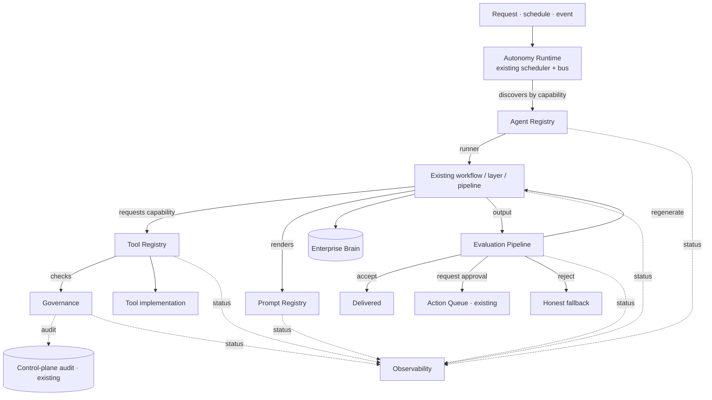
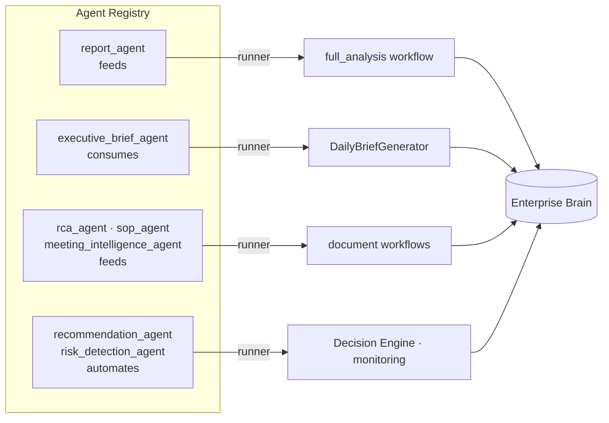
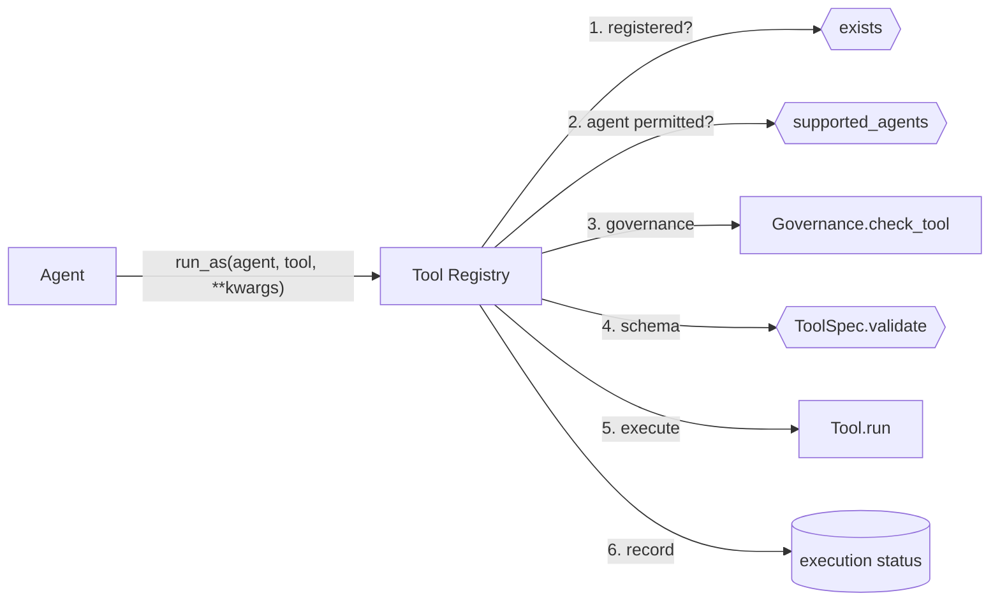
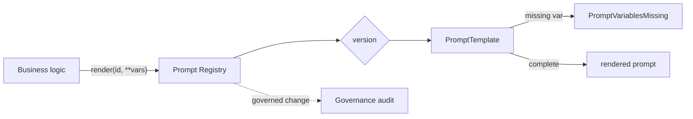
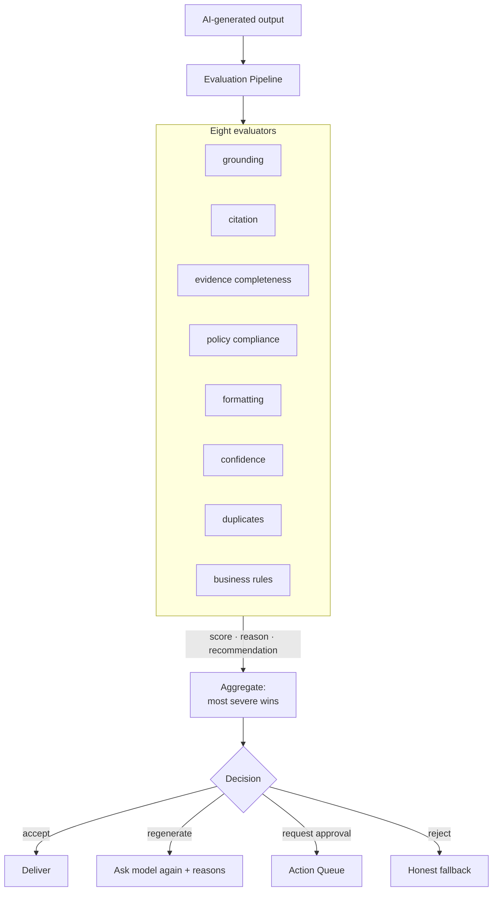
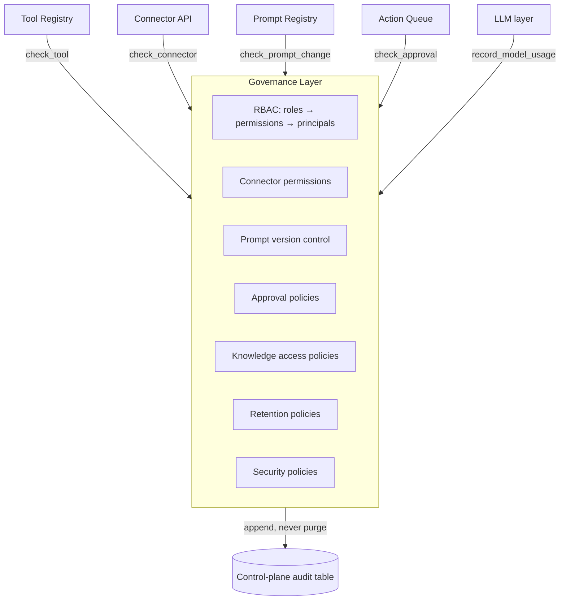
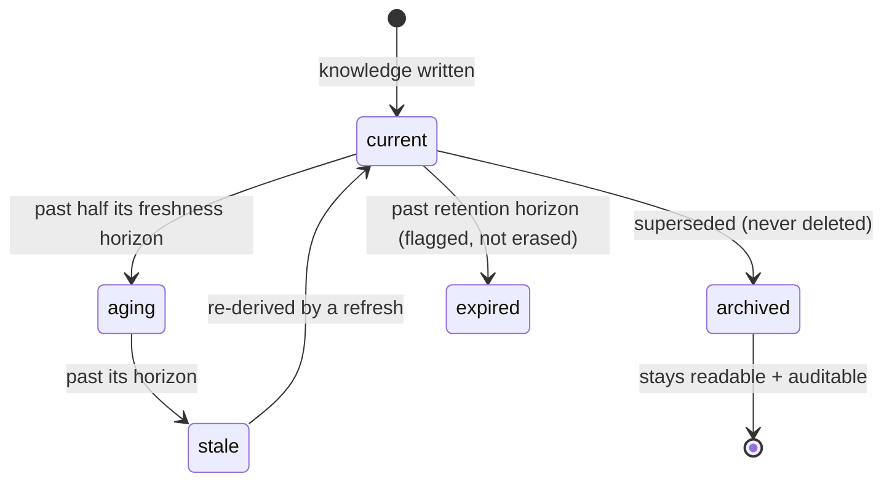
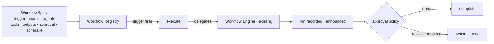
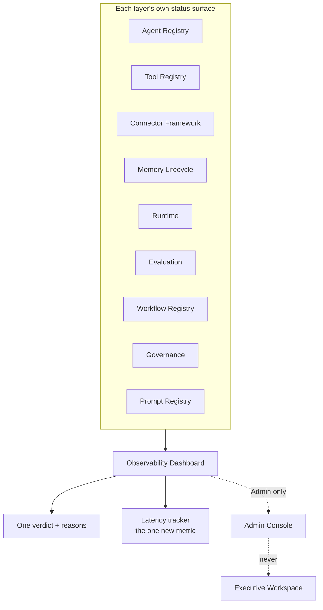

# Enterprise AI Operating Layer — Version 2.2

The Enterprise Intelligence Platform (V1) and the Enterprise Connector
Framework (V2.1) made the platform *intelligent*. V2.2 makes it
*operable* — it adds the governance, evaluation, registries, and observability
an enterprise needs to run AI in production.

## Guiding principle

The **Enterprise Brain remains the centre**. Everything in this layer either
**feeds** the Brain, **consumes** it, **validates** it, or **automates** work
using it. Agents are implementation details; the descriptor for every one of
them records which of those four roles it plays.

This is **not** a generic multi-agent framework, and building one was the
explicit non-goal. Every component here is a *catalogue*, an *authority*, or a
*composition* over implementations that already existed:

| Layer | What it is | What it does NOT do |
|---|---|---|
| Agent Registry | catalogue over existing workflows/agents | reimplement any agent |
| Tool Registry | specs over existing tools | replace the V1 tool layer |
| Prompt Registry | prompts extracted from code | change any prompt's wording |
| Evaluation | panel that delegates to V1 checkers | replace `_verify_evidence` |
| Governance | one policy authority | open a second audit log |
| Memory Lifecycle | read-and-annotate over the Brain | delete knowledge |
| Workflow Registry | declarations over the engine | become a second orchestrator |
| Observability | composition of status surfaces | compute new metrics |

The Runtime, the Scheduler, and the Enterprise Brain are **untouched**.

---

## Execution flow

Where the operating layer sits between a request and the Brain:



Everything with "existing" already ran in V2.1. The operating layer is the
ring around it.

---

## 1. Agent Registry

Every autonomous capability registers an `AgentDescriptor`:

```
id · name · description · capabilities · inputs · outputs · required_tools
execution_policy · approval_policy · brain_role · implementation · runner
```

The Runtime discovers agents by what they *do* — `find(capability="summarize")`
— instead of importing a class. That is what "do not hardcode agent execution"
means concretely.



The SDS names eleven agents. All eleven already existed as workflows, layers,
or pipelines; the catalogue (`app/agents/catalogue.py`) gives each one a
descriptor and a thin runner adapter. A capability whose implementation is
disabled in a deployment registers **without** a runner and reports its health
as `catalogue` — declared, not broken.

**Health** is observed from real executions: runs, failures, consecutive
failures, average duration, success rate. Three consecutive failures move an
agent to `unavailable`.

---

## 2. Tool Registry



Each tool carries a `ToolSpec`: `capability`, `permissions`,
`supported_agents`, and `inputs`/`outputs` schema. The moment an LLM is allowed
to choose a tool, "what arguments does this take" becomes a contract — so it is
declared and validated at the boundary instead of failing inside the tool.

Backward compatible: `register(tool)`, `get(name)`, and `run(name, **kwargs)`
keep their V1 signatures; a tool registered without a spec gets a conservative
read-only one.

---

## 3. Prompt Registry

Every prompt the platform sends to a model is declared in a domain module,
never embedded in the code that uses it:

```
app/prompts/domains/
  executive.py  reports.py  meetings.py  communications.py
  analytics.py  rca.py  sop.py  forecast.py  copilot.py
```

Each `PromptTemplate` has a version, an owner, tags, declared variables (derived
from the template so they cannot drift), and a change history. Rendering with a
missing variable raises at the boundary rather than interpolating the word
`None` into an executive report.



The evidence-contract system prompt — the text that makes every generated
report evidence-bound — is `reports.evidence_narrator`, marked `governed`. It
was moved verbatim out of `prompt_generator.py`; V2.2 is a relocation, not a
behaviour change.

---

## 4. Evaluation Pipeline



Each evaluator returns **score, reason, recommendation**. Aggregation takes the
**most severe** recommendation — an output that is well formatted, well cited,
and contradicts a business rule is not 75% acceptable. Grounding, citation, and
policy compliance **delegate to the V1 `ResponseValidator` helpers**, so there
is one implementation of "does this figure appear in the evidence".

A broken evaluator is recorded and skipped, never allowed to fail the analysis.
Disabling the pipeline returns the platform to V2.1 — the V1 guards
(`_verify_evidence`, `ResponseValidator`) remain in place beneath it.

---

## 5. Governance Architecture



Two commitments:

- **Fails closed.** An unknown or unassigned role grants nothing. The failure
  mode of a governance layer must be refusal, not silent access.
- **Advisory until installed.** With `governance_enabled=false` every gate is
  open and behaviour is exactly V2.1. A deployment *adopts* governance by
  configuring principals and narrowing `governance_default_role`.

Default roles ship so a deployment starts governed: `executive`, `manager`,
`analyst`, `administrator`, `system`. Administrators operate the platform but
are **not** automatically approvers — operating the machine and approving what
it sends are different duties.

Audit writes through the existing `EvidenceLedger.audit` (the append-only
control-plane table), never a second log. Model-usage logging records
provider, model, prompt id, tokens, and duration for cost attribution.

---

## 6. Memory Lifecycle

The Brain already *learns*. V2.2 gives its knowledge a *lifecycle* so it
evolves instead of only accumulating.



- **Freshness** — how current each class of knowledge is (documents, entities,
  relationships, insights, decisions), and what is overdue.
- **Versions & history** — document version lineage, entity history, decision
  history, all read from where they already live.
- **Expiry** — records past their Governance retention horizon, **reported not
  deleted**.
- **Evolution** — how relationships changed: new links, and links whose
  confidence moved.

Everything is read-and-annotate. Nothing is erased — the same commitment the
audit log makes.

---

## 7. Workflow Lifecycle



Ten workflows are declared — Daily Executive Brief, Weekly KPI Report, Monthly
Product Review, Meeting Processing, RCA Processing, SOP Change Detection, Risk
Monitoring, Email Draft, Presentation, Knowledge Refresh — each naming a
workflow the engine already runs. The registry **declares and routes**; the
existing engine still owns running steps, recording runs, and announcing
completion. A spec whose workflow is not registered here reports itself
unavailable rather than pretending.

---

## 8. Enterprise Observability



The dashboard **composes** — asking each owner is what stops one number from
having two answers. It computes almost nothing itself; processing latency is
the one metric that genuinely had no owner. Every section degrades
independently: a disabled or failing layer reports itself unavailable instead
of failing the page. One overall verdict (healthy / degraded / unhealthy /
unknown) is derived, and every concern that moved it is named.

**Admin-only.** Nothing here touches business dashboards — an executive sees
reports and approvals, never agent health.

---

## API surface (Admin only)

All under `/api/v1/ops`:

| Method | Path | Description |
|---|---|---|
| GET | `/ops/observability` | The whole dashboard, one verdict |
| GET | `/ops/observability/{section}` | One section |
| GET | `/ops/agents` · `/ops/agents/{id}` | Agent catalogue + health |
| POST | `/ops/agents/{id}/run` | Execute an agent (policy-gated) |
| GET | `/ops/tools` | Tool catalogue with specs + status |
| GET | `/ops/prompts` · `/ops/prompts/{id}` | Prompts, versions, history |
| GET | `/ops/evaluation` · `/ops/evaluation/history` | Evaluators + verdicts |
| GET | `/ops/governance` · `/audit` · `/model-usage` | Policy, audit, usage |
| POST | `/ops/governance/assign` | Assign a principal to a role |
| GET | `/ops/memory/lifecycle` · `/freshness` · `/evolution` | Memory lifecycle |
| GET | `/ops/workflows` | Declared workflows |
| POST | `/ops/workflows/{id}/run` | Execute a workflow |

---

## Configuration

| Setting | Default | Meaning |
|---|---|---|
| `EDIP_EVALUATION_ENABLED` | `true` | Off = V1 guards remain the only gate |
| `EDIP_GOVERNANCE_ENABLED` | `true` | Off = every gate open (V2.1 behaviour) |
| `EDIP_GOVERNANCE_DEFAULT_ROLE` | `administrator` | What an unidentified caller is treated as |
| `EDIP_OBSERVABILITY_LATENCY_ENABLED` | `true` | Sample latency on the hot path |

---

## Backward compatibility

V2.2 is **additive**. The V1 `AgentRegistry` and `ToolRegistry` signatures are
preserved (the classes moved, the API did not). Prompts render identically —
the text was relocated, not rewritten. Every new layer can be disabled to
return the platform to exactly V2.1 behaviour. The Runtime, Scheduler, and
Enterprise Brain were not modified. All 540 backend tests pass; the frontend
builds clean.
