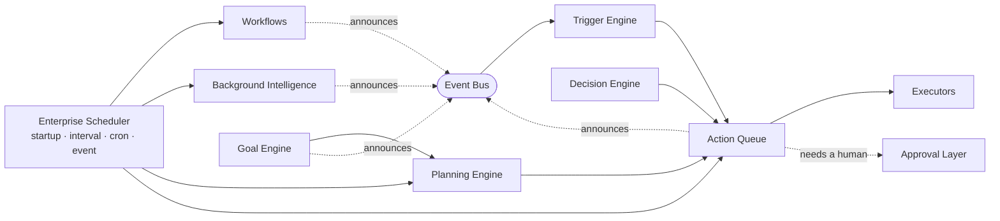
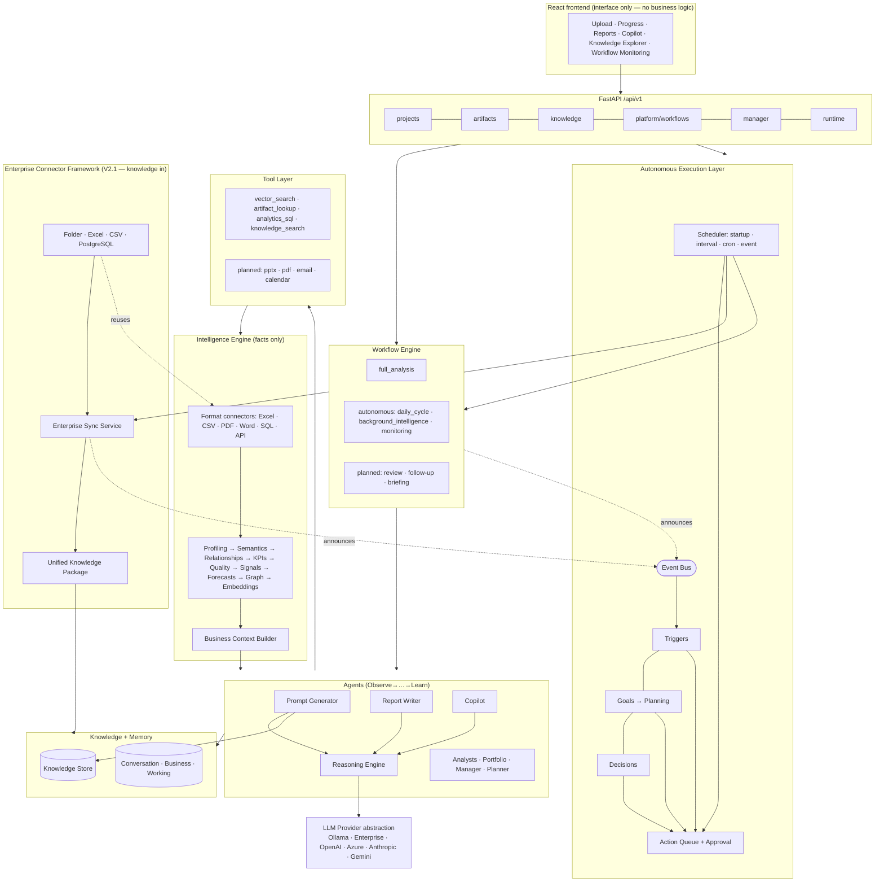
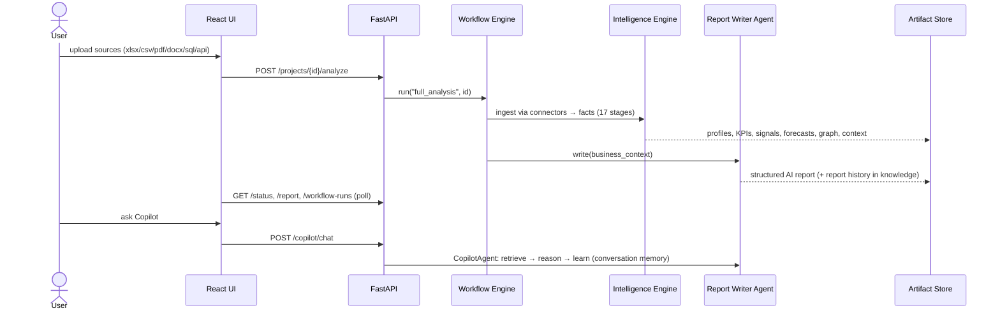
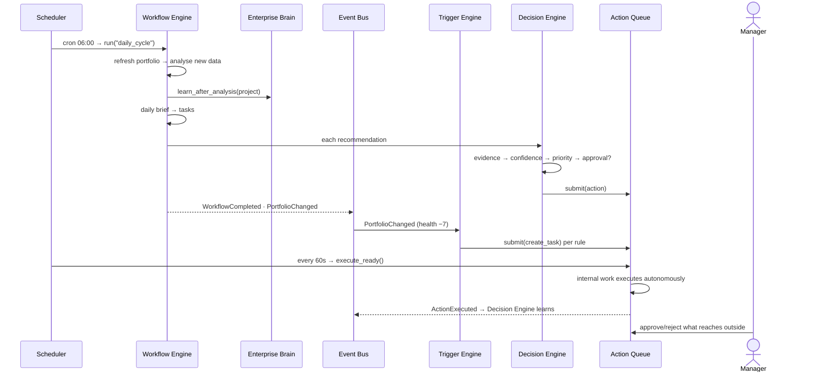

# Architecture

EAPIP (Enterprise Autonomous Product Intelligence Platform) is the foundation
for a **Digital Product Manager**: a system of specialized intelligence
engines, agents, enterprise knowledge, memory, a workflow engine, a tool
layer, and a provider-agnostic LLM layer. The LLM is one component — it is
never the application.

```
Enterprise Intelligence Engine   (connectors + deterministic analytics — facts only)
        ↓
Enterprise Knowledge             (terminology, rules, clarifications, history)
        ↓
Specialized Agents               (prompt generator, report writer, copilot,
                                  schema/business analysts, portfolio, manager, planner)
        ↓
Enterprise Workflow Engine       (full analysis, plus autonomous chains:
                                  daily cycle, background intelligence, monitoring)
        ↓
Autonomous Execution Layer       (scheduler, event bus, triggers, goals,
                                  planning, decisions, action queue)
        ↓
Knowledge Synchronization Layer  (source registry, incremental sync,
                                  organizational model, relationships,
                                  refresh pipeline, enterprise search)
        ↓
Product Intelligence Layer       (catalog, health, growth, strategy, KPIs,
                                  scenarios, portfolio, executive briefs)
        ↓
Enterprise Copilot Layer         (intent, planner, context, evidence, prompt,
                                  LLM router, validator, conversations)

Enterprise Connector Framework   (V2.1 — connector interface, registry,
                                  Knowledge Packages, Enterprise Sync Service:
                                  the uniform way knowledge gets IN)
```

The platform is **proactive, not reactive**: when Enterprise Agent starts it
observes, learns, plans, executes, monitors, and improves on its own
heartbeat. The manager reviews, approves, communicates, and makes strategic
decisions; the agent does the operational work. See
[the Autonomous Execution Layer](#8-autonomous-execution-layer--appruntime).

## Layers

### 1. Intelligence Engine — `app/intelligence`

The single facade (`engine.py`) over every deterministic capability. It
produces **facts only** and never generates executive recommendations.

- **Connectors** (`intelligence/connectors/`) — every enterprise data source
  enters through the `DataConnector` abstraction: Excel, CSV/TSV, PDF tables
  (optional `pdfplumber`), Word tables (optional `python-docx`), SQL databases
  (`*.sqlsource.json` descriptor → SQLAlchemy), REST APIs (`*.apisource.json`
  descriptor → httpx). Excel is one connector among many, not the core
  product. Unavailable connectors self-describe what they need.
- **Analytical engines** — profiling, semantics (ontology + fuzzy matching),
  dedup/partition merge, relationship detection, time series, KPI discovery,
  data quality, DuckDB analytics warehouse, statistical signals (trends,
  anomalies, correlations, concentration), forecasting, knowledge graph,
  embeddings, and the Business Context Builder that condenses everything into
  one compact JSON — the only thing reasoning agents ever see.

### 2. Enterprise Knowledge — `app/knowledge`

Persistent, organization-wide learning (`data/knowledge/*.json`, swappable
for a database): business terminology and aliases, schema aliases, entity
definitions, business rules, **user clarifications** (never asked twice for
similar data), decision history, and report history. Knowledge is injected
into every reasoning prompt, so the system gets smarter over time.

### 3. Memory — `app/memory`

- **WorkingMemory** — scratch state for one agent run.
- **ConversationMemory** — persisted per-project chat history (copilot recall).
- **BusinessMemory** — a project's analytical artifacts.
- **OrganizationalMemory** — the enterprise KnowledgeStore (long-term).

### 4. Agents — `app/agents`

Every agent follows `Observe → Understand → Plan → Choose Tools → Execute →
Verify → Learn` (`base.py`). Registered agents:

| Agent | Responsibility |
|---|---|
| `prompt_generator` | Observes schema/analytics/knowledge, generates the best prompt, asks clarification questions when confidence is low |
| `report_writer` | Executive narrative (summary, risks, opportunities, recommendations) from facts, via the reasoning model — never templates |
| `copilot` | Grounded Q&A over a project's analytics with conversation memory |
| `schema_analyst` | Datasets, semantics, relationships |
| `business_analyst` | KPIs, signals, forecasts, quality |
| `portfolio` | Portfolio health across analyses (report history) |
| `manager` | Turns recommendations into trackable priority actions |
| `planner` | Routes a goal to the right agent/tools |

### 5. Tools — `app/tools`

Named capabilities agents invoke: vector search, artifact lookup, read-only
analytics SQL, knowledge search, report markdown — plus planned tools
(PowerPoint, PDF export, email, calendar) that self-describe the integration
they need. New capability = new Tool; no other layer changes.

### 6. Workflow Engine — `app/workflows`

Registered units of autonomous work with persisted run history. Two shapes
share one engine, one history, and one monitoring surface:

- **single-runner** workflows wrap one callable — `full_analysis` (the
  analysis graph);
- **autonomous** workflows are ordered step chains the engine executes with
  no user present (`workflows/autonomous.py`). A step receives the results
  of the steps before it; an `optional` step degrades the run instead of
  ending it, so a cycle produces what it can rather than nothing.

| Workflow | Chain |
|---|---|
| `daily_cycle` | refresh portfolio → analyse new data → update Enterprise Brain → generate daily brief → create tasks → generate recommendations → queue communications |
| `background_intelligence` | refresh portfolio → refresh brief → decide on recommendations |
| `monitoring` | refresh portfolio → check deadlines → alert |

Report review, follow-ups, and executive briefings remain registered as
planned so they plug in without architectural change.

### 7. LLM Layer — `app/llm`

Provider-agnostic (`Ollama` for development, enterprise fine-tuned gateways
for production, plus OpenAI/Azure/Anthropic/Gemini). Selected by
`EDIP_LLM_PROVIDER` alone; nothing outside `provider_factory.py` knows
providers exist. With no provider, AI sections report `unavailable` — the
platform never substitutes template narrative.

### 8. Autonomous Execution Layer — `app/runtime`

The heartbeat. Built at container time, started by the application
(`EDIP_AUTONOMY_ENABLED=false` turns the ticking off without removing any
surface: every engine still works on demand and every API still answers).



**Enterprise Scheduler** (`scheduler.py`) — the heartbeat. Four job kinds:
`startup` (once, in dependency order), `interval`, `cron` (a dependency-free
5-field parser lives in `cron.py`), and `event` (runs when an event kind is
published). Dependency ordering, retry policies with exponential backoff,
and failure recovery belong to the scheduler, not to each job: a job that
keeps failing is backed off (capped) rather than becoming a hot loop, and is
reported as degraded. `tick()` is public so the heartbeat is a thread in
production and a function call in tests.

**Event Bus** (`events.py`) — modules announce what happened; they never call
each other to make things happen. A producer publishes `DatasetImported`; the
Trigger Engine, event jobs, and (in V2) communication modules subscribe.
Delivery is synchronous and best-effort: a failing subscriber is recorded on
the event and never propagated to the publisher, because a notification bug
must not fail an analysis. The vocabulary is closed (`EVENT_KINDS`) — the bus
is a contract between modules, not a free-text channel.

**Trigger Engine** (`triggers.py`) — configurable rules over the bus, stored
as JSON and editable over the API without a deploy. Conditions use a
deliberately non-Turing-complete language (dotted field path, operator,
value), and rule actions name an action kind the queue already understands,
so **no trigger can execute arbitrary code or bypass approval**. The SDS
defaults (risk up → task, report approved → summary, new dataset → refresh,
anomaly → recommendation, confidence drop → investigation) seed once; an
operator who deletes or disables one keeps it that way.

**Goal Engine** (`goals.py`) — objectives with KPIs, targets, directions, and
deadlines. Progress is *measured*, never asserted: each KPI names a platform
metric (`portfolio.average_health_score`, `tasks.open`, …) that the
background jobs refresh from the platform's own numbers, and goal progress is
the mean of its KPIs' attainment, so a goal cannot look healthy because one
metric ran ahead. Deadlines are swept: behind and close = `at_risk`, past =
`missed`.

**Planning Engine** (`planning.py`) — the third planning surface (with the
graph's run-level planner and `PlannerAgent`) and the one autonomy needs:
business objective → durable plan of steps (workflow, queued action, or KPI
measurement) → advanced on the scheduler → **replanned when conditions
change**. A stalled goal, a closing deadline, or a step that failed past its
attempt budget revises the remaining plan automatically; completed work is
carried forward, and a superseded plan never comes back.

**Decision Engine** (`decisions.py`) — the pipeline from a recommendation to
a learned outcome:

```
Recommendation → Evidence → Confidence → Priority → Approval required?
               → Execute → Monitor → Learn
```

Every stage is recorded on the decision, so "why did the agent do that?" is
answered by data: which evidence was cited, what confidence it carried, why
it needed a human, what the queue did, and what was learned. An uncited
recommendation is trusted less than a cited one; below
`EDIP_AUTONOMY_CONFIDENCE_THRESHOLD` a human decides whatever the action is.
**Autonomy is bounded by evidence, never by optimism.**

**Action Queue** (`queue.py`) — the execution centre. Nothing the platform
does to the outside world happens inline: every communication, workflow,
approval, and automation is queued first.

```
submit → pending_approval ──approve──> approved → executing → executed
           │                                          └─fail─> failed
           └──reject──> rejected
submit → approved (auto)   when the action's kind needs no human
```

The approval policy is configuration (`EDIP_AUTONOMY_REQUIRES_APPROVAL`), not
code. Sending email, creating meetings, updating business rules, and
executing automation require a human; internal reversible work does not.
Executors register per kind — a kind with no executor **holds its approval
and waits**, which is exactly the seam V2 communication providers plug into,
with the approval trail already working before the first email exists.

**Background Intelligence** (`background.py`) — knowledge, memory, portfolio,
predictions, risks, opportunities, and recommendations stay current with no
user interaction. Each job is idempotent, bounded, and degrades to a recorded
skip rather than an exception.

### 9. Enterprise Knowledge Synchronization Layer — `app/sync`

The Brain learns from analyses; this layer keeps it learning from the
*enterprise*. Once systems are connected, organizational knowledge updates
continuously with nobody pressing anything (`EDIP_SYNC_ENABLED=false` stops
the refresh; every surface still answers on demand).

**Data Source Registry** (`registry.py`) — what is connected, how healthy it
is, how often it refreshes, where its sync got to. Source kinds cover the SDS
catalogue; what a kind can *do* is its capability, not its presence:
`native` reads through an existing connector today (CSV, Excel, REST, and the
SQL family — PostgreSQL/SQL Server/MySQL/Oracle differ only by the driver in
the URL, so there is no provider-specific code); `interface` means the
contract exists and the provider arrives in V2 (SharePoint, Outlook, Teams).
An interface-only source can be registered — it appears as "awaiting
integration" and is never synchronized.

> **Credentials are never stored.** A source carries an auth *reference* (an
> environment variable name), resolved in memory at sync time only. The
> registry rejects a secret value passed to it and rejects a credentialed URL
> pasted into `location`. `describe()` cannot leak a secret because the secret
> was never there. The SQL/REST connectors take a descriptor file, so one is
> materialized in a temp file with the resolved credential and deleted in a
> `finally` — the credential exists on disk only inside one sync.

**Synchronization Engine** (`engine.py`) — a sync is a comparison, not a
reload. Every record gets a stable key and a content fingerprint; the next sync
emits only `added` / `changed` / `removed`, and reports the rest as
`unchanged`. First sync → `first`; later → `delta`; failures are recorded and
retried with backoff. **A failed sync never destroys the last good
fingerprints**, so a recovered system resumes with a delta instead of
re-learning everything. Each success increments the source's version.

**Organizational Model** (`organization.py`) — the enterprise's entities
(products, customers, merchants, banks, teams, departments, employees,
reports, projects, meetings, business rules, KPIs), each with identity (a
canonical name plus the aliases other systems know it by — `MID` here,
`merchant_id` there, one merchant), ownership, provenance, and history.
Entities are *observed*, never invented: each derives from a synced record, a
semantic mapping, or a platform object. A table nobody can interpret
contributes nothing — this model would rather be small and true than large and
invented. It mirrors into the enterprise knowledge graph (which owns
relationships) and the Knowledge Store (which owns definitions); nothing is
duplicated.

**Relationship Engine** (`relationships.py`) — how the enterprise is wired:
ownership, dependencies, hierarchies, associations, and cross-domain links (the
same entity seen in two systems — what makes the model *one* organization).
Every link is evidenced and carries a confidence that strengthens with
corroboration, capped below certainty. Dependencies reuse the foreign keys Data
Intelligence already proved; only meaningful entity pairings are associated,
because noise in a knowledge graph gets reasoned over.

**Knowledge Refresh Pipeline** (`pipeline.py`) —

```
Synchronize → Observation → Knowledge Update → Memory Update
  → Relationship Update → Embeddings Update → Enterprise Context Update → Ready
```

Incremental by construction: every stage consumes the delta, and a refresh with
an empty delta short-circuits to `ready` having done no work. History is
preserved, never overwritten (the Knowledge Store journals every mutation).
Degradation is per-stage — a failing embeddings backend must not cost the
organization its knowledge update — so the pipeline reports `degraded` rather
than failing, the Brain's contract applied to sync.

**Enterprise Search** (`search.py`) — one query across knowledge, memory,
projects, reports, tasks, portfolio, business rules, clarifications,
recommendations, and the organization. Each surface is searched by the
component that owns it; nothing is reindexed and no second copy of the truth
exists. Ranking is explainable (every hit says what matched and why), an alias
match ranks as strongly as a name match, and a failing surface is reported as
unavailable while the rest still answers.

### 10. Product Intelligence & Strategic Decision Layer — `app/product`

The Enterprise Product Manager. It sits **above** the Enterprise Brain and
consumes it: it computes no analytics, trains no models, and holds no facts of
its own (`EDIP_PRODUCT_ENABLED=false` stops the recalculation; every surface
still answers on demand).

**Evidence** (`evidence.py`) — the single place that gathers the facts a
product judgement may stand on (KPIs, signals, forecasts, quality, insights,
reports). It collects and indexes; it does not interpret. If a fact is not
here, no engine can cite it — and an engine that cannot cite must not
conclude. This is what makes "evidence-based" checkable rather than
aspirational.

**Product Catalog** (`catalog.py`) — products with identity, owner, business
unit, lifecycle, status, dependencies, KPIs, and the merchants, customers, and
reports each touches. Associations are **resolved from the Organizational
Model's relationship graph**, not re-detected; a product the model has never
seen cannot be invented here.

**Product Health Engine** (`health.py`) — eight scores (health, growth, risk,
stability, adoption, revenue, satisfaction, merchant engagement), each derived
from evidence and each carrying its reason. Where evidence does not support a
dimension the score is `None`, not 0: **"unknown" and "bad" are different
answers**, and conflating them defunds products that were merely
uninstrumented. The composite is computed over what *is* known, with
`confidence` reporting how much of the picture was visible.

**Growth Intelligence** (`growth.py`) — opportunities, decline, emerging
trends, cannibalization, cross-sell, portfolio gaps, expansion. Cannibalization
reads the Analytics module's `INVERSE_CORRELATION` signal, which that module
already names the cannibalization candidate; concentration reads its
`CONCENTRATION` signal. Direction belongs to what a KPI measures, not to the
arithmetic: a rising failure rate is a risk, never a growth opportunity, and a
falling one is not a decline.

**Strategic Recommendation Engine** (`strategy.py`) — business plays (improve
onboarding, reduce failures, increase merchant adoption, improve retention,
expand partnerships, optimize pricing, launch campaign, improve reliability),
each with business impact, confidence, evidence, priority, estimated effort,
and dependencies. A recommendation that cites no evidence **cannot be
constructed** — the constructor raises. This engine proposes; the existing
Decision Engine disposes, routing each through the approval policy that already
exists. No second approval path.

**Product Review Engine** (`reviews.py`) — executive summary, strengths,
weaknesses, risks, recent changes, recommendations, evidence, confidence,
action items. Empty sections state the absence rather than padding: an empty
section that reads as a clean bill of health is a lie. Reviews register with
the existing Report Review Center.

**KPI Intelligence** (`kpis.py`) — business / growth / operational / portfolio
KPIs watched against thresholds that are data, not code. A breach becomes work
through the existing task manager, notification centre, and bus. It reports two
different facts: how many KPIs are *breaching* (the state of the business) and
how many are *new* (what deserves attention now) — a still-breaching KPI is
still true, it just must not nag every heartbeat.

**Scenario Simulation** (`scenarios.py`) — "what happens if…", applied to the
platform's real KPI values and real forecasts. Three rules: nothing is
fabricated (a scenario over an unmeasured KPI returns "cannot simulate",
naming what is missing); confidence is **inherited** from the underlying
forecast, including its validation gate, never asserted; and assumptions are
stated in the output — linearity and *ceteris paribus* are modelling
assumptions, not facts about the business.

**Portfolio Intelligence** (`portfolio.py`) — portfolio health, risk, growth,
product ranking, and investment priority (`invest` / `fix` / `maintain` /
`watch` / `question`) by one stated rule, with the reason travelling with every
verdict. Unmeasured products rank last and are `watch`, never defunded: that is
a decision about instrumentation, not investment.

**Executive Briefs** (`briefs.py`) — board brief, monthly product review,
quarterly strategy, risk summary, growth summary, decision pack. Composed,
never computed, and rendered with the Report Generation Module's own
convention: structured JSON plus a Jinja Markdown view.

### 11. Enterprise Copilot Layer — `app/copilot`

The executive's primary way in. Its responsibility is **orchestration, not
calculation**: it understands what is being asked, decides which existing
modules can answer, gathers their evidence, and has the reasoning model narrate
it. It computes no analytics and holds no truth of its own
(`EDIP_COPILOT_ENABLED=false` disables the surface; nothing else is affected).

```
intent → plan → context → evidence → prompt → LLM → validate
       → suggested actions → remember
```

**Intent Understanding** (`intent.py`) — fifteen SDS intents, classified
**deterministically** by scored keyword and shape evidence. Three reasons this
is not an LLM call: routing decides which modules run, so a hallucinated
*route* produces a confidently wrong answer before the answering model sees a
fact; it must work with `EDIP_LLM_PROVIDER=none`; and it runs on every message,
where a round-trip buys nothing. Ambiguity is reported with the runner-up
rather than hidden. Subjects (product names) are **learned from the catalogue**
on the scheduler — an unknown noun is never a subject.

**Request Planner** (`planner.py`) — one route per intent, as declarative
data: which modules speak, in what order, what evidence they must produce, what
approvals are implied, and what the answer should look like. A plan may only
name capabilities that already exist — the orchestrator raises on an unknown
module, which is what stops this layer drifting into a second analytics engine.
Order is context-before-evidence-before-judgement, so a KPI is read in the
organization's own terms.

**Context Builder** (`context.py`) — what the organization *is*: brain,
knowledge, memory, organization, portfolio, product, reports, tasks,
recommendations, business rules, recent decisions, recent conversations. Every
source optional; a missing collaborator contributes a **recorded absence**
(surfaced as `context_gaps`), never an exception.

**Evidence Collector** (`evidence.py`) — what is *true right now*, gathered
**before the model is asked anything**: analytics, KPIs, forecasts (validation
gate and all), recommendations, reports, knowledge, relationships, business
rules, product reviews, portfolio health. Every item carries a citable `id`;
an item without one is dropped, because evidence the validator cannot enforce
is not evidence.

> Context and evidence are deliberately separate. The model may reason **in**
> the context but may only make claims **from** the evidence.

**Prompt Builder** — the existing `PromptGenerationAgent` gains an
`enterprise_copilot_prompt`; prompts stay owned by the module that owns
prompts. It carries the SDS structure — system context, business context,
evidence, request, output format, confidence requirement, hallucination
prevention — on top of the platform's existing evidence contract.

**LLM Router** (`router.py`) — **no provider code**. `app/llm/` already selects
Ollama / OpenAI / Azure / Anthropic / Gemini / enterprise from configuration.
The router adds only what the copilot needs on top: primary-then-fallback
routing (matching the report path), and reporting which provider answered.

**Response Validator** (`validator.py`) — the gate between a language model and
an executive who will act on the sentence:

| Check | Outcome |
|---|---|
| citation to evidence that was not supplied | stripped — the model does not name its own sources |
| a KPI the evidence never mentioned | rejected |
| a figure absent from the evidence *and* the business rules | rejected |
| an answer contradicting an explicit prohibition | rejected |
| an answer citing nothing | confidence capped at 0.3 |
| thin evidence | confidence capped at 0.4 |

A rejected answer is **replaced with an honest one** — what was asked, what was
rejected and why, and the evidence that does exist. Rounding is tolerated,
trivial numbers in prose are ignored, numbers quoted from business rules are
legitimate, and a refusal may cite nothing: a gate that rejects correct answers
gets switched off, so its false-positive rate is part of its design.

**Deterministic intents** — approvals, tasks, workflows, search, and decisions
are things the platform *knows*. They are answered by the owning module
verbatim, with no model involved: rephrasing a known fact adds latency and a
chance of error and buys nothing. The copilot never approves anything; it
surfaces what is queued and a human decides in the Action Queue.

**Conversations** (`conversations.py`) — history, follow-up resolution
(recent turns travel into the prompt for reference only, never as facts), and
preferences **counted** from real usage rather than inferred. Clarifications go
to the Knowledge Store, which already guarantees they are never asked twice.
Pinned threads are never pruned.

### 12. Enterprise Connector Framework — `app/connectors`

**Version 2.1.** Every layer above answers questions about what the enterprise
knows. This one is how the enterprise's knowledge gets *in* — continuously,
with nobody uploading anything. An administrator configures a data source
once; the Runtime keeps it synchronized forever.

Full detail, diagrams, and the connector authoring guide:
[CONNECTOR_FRAMEWORK.md](CONNECTOR_FRAMEWORK.md).

**The contract** (`base.py`) — every source connector implements the same
lifecycle, so the framework knows nothing provider-specific:

```
initialize · connect · test_connection · discover · sync · incremental_sync
fetch_metadata · fetch_content · health · disconnect
```

`incremental_sync` defaults to a full `sync`, which is always *correct* — a
connector that cannot do better is slower, not wrong. Failure is a typed
result (`ConnectorNotConfigured`, `ConnectionFailed`, `SyncFailed`), and each
error declares whether a retry is worth it: only the connector knows that a
dropped socket deserves another attempt while a missing credential does not.

**Two connector layers, deliberately.** `app/intelligence/connectors` holds
*format* connectors — one file in, tabular extracts out, no lifecycle, no
state. `app/connectors` holds *source* connectors — a configured system, over
time. Source connectors **use** format connectors for content extraction;
they do not replace them. One implementation of "where does the table start
in this messy sheet" is enough.

**Unified Knowledge Package** (`package.py`) — the one shape every connector
produces: source id, connector type, file type, title, author, created and
modified dates, tags, checksum, raw content, structured metadata, version, and
permissions. Document Intelligence, the embedding pipeline, the knowledge
graph, and memory consume packages and never branch on origin. That is what
makes the tenth connector cost nothing anywhere else. `raw_content` never
persists — a package record is metadata and a checksum; content flows through
the pipeline in memory.

**Connector Registry** (`registry.py`) — kinds are registered by dotted path
and loaded dynamically, so a new connector is one module plus one catalogue
entry, or a runtime `load()` from a deployment's own package with nothing in
this repository touched. A kind whose module will not import is reported as
unavailable *with the reason*; a missing optional driver degrades one
connector, never the catalogue.

**Enterprise Sync Service** (`service.py`) — one engine around every reader:
configuration, due-source selection, change detection, ingestion queueing,
retries with backoff, sync history, failure records, and event publication.
`sync_one` never raises — an unreachable database degrades itself, records
why, and the other twelve sources synchronize normally on the same tick.

**It owns no heartbeat.** The framework registers four jobs on the
**existing** Enterprise Scheduler (`connector_health`, `connector_sync`,
`connector_sync_boot`, `connector_full_sweep`) and announces on the
**existing** Event Bus. There is exactly one clock in the platform.

**Connectors shipped in V2.1:** Folder (PDF · DOCX · PPTX · XLSX · CSV · TXT ·
Markdown, change detection by content hash so a touched-but-identical file is
correctly unchanged), Excel (sheets, detected tables, column schema and types),
CSV (the same, minus the sheet dimension), and PostgreSQL (schema discovery,
table and column metadata, keys, indexes, watermark-based incremental sync).
Excel, CSV, and PostgreSQL extract **structure, not statistics** — profiling,
KPIs, and forecasting are downstream layers and stay there.

**Credentials are never stored**, exactly as in the Synchronization Layer: a
source carries an auth *reference* (an environment variable name) resolved in
memory at connect time. Driver errors are scrubbed before they reach a log or
the Admin console, because SQLAlchemy puts the URL in some messages.

**Managers never see any of this.** The Executive Workspace exposes no
connector surface at all — it receives updated reports, fresh insights,
generated summaries, approvals, and notifications. Configuration lives in the
Admin Console under **Enterprise Data Sources**.

### 13. Enterprise AI Operating Layer — `app/agents`, `app/tools`, `app/prompts`, `app/evaluation`, `app/governance`, `app/memory`, `app/workflows`, `app/observability`

**Version 2.2.** The operational layers *around* the intelligence. The
Enterprise Brain stays the centre; everything here feeds it, consumes it,
validates it, or automates work with it. Full detail and diagrams:
[AI_OPERATING_LAYER.md](AI_OPERATING_LAYER.md).

The guiding constraint of this milestone was **do not build a second
framework**. Every layer below is a catalogue, an authority, or a composition
over implementations that already existed — the Agent Registry runs existing
workflows, the Evaluation layer delegates to the existing validator, the
Workflow Registry drives the existing engine, Observability composes existing
status surfaces. Nothing was reimplemented, and the Runtime and Scheduler are
untouched.

**Agent Registry** (`app/agents/registry.py`, `catalogue.py`) — every
autonomous capability declares an `AgentDescriptor`: id, capabilities,
inputs/outputs, required tools, execution policy, approval policy, `brain_role`
(feeds/consumes/validates/automates), and a `runner`. The Runtime **discovers
agents by capability** and executes them through the registry, so execution is
no longer hardcoded. The catalogue maps the SDS's named agents (Executive
Brief, RCA, SOP, Meeting, Report, …) onto the workflows and layers that already
implement them — a thin adapter each, never a new agent. Health is observed
from real executions, not declared.

**Tool Registry** (`app/tools/registry.py`, `specs.py`) — every tool carries a
`ToolSpec`: capability, permissions, supported agents, and input/output schema.
Agents request capabilities through the registry rather than importing
implementations; inputs are validated and governance is checked before every
call, and execution status is recorded after. Backward compatible: `register`,
`get`, `run` keep their V1 signatures.

**Prompt Registry** (`app/prompts`) — every LLM prompt is declared in a domain
module (`executive`, `reports`, `meetings`, `communications`, `analytics`,
`rca`, `sop`, `forecast`, `copilot`), versioned, owned, with a change history.
**No prompt remains embedded in business logic**: the prompt agent renders from
the registry. Governed prompts (the evidence contract, the drafting templates)
are flagged, because their wording is a compliance artifact.

**Evaluation Framework** (`app/evaluation`) — eight evaluators (grounding,
citation, evidence completeness, policy compliance, formatting, confidence,
duplicates, business rules), each returning score + reason + recommendation.
The pipeline aggregates them into one decision — accept, regenerate, request
approval, reject — taking the *most severe* recommendation, never an average.
Grounding, citation, and policy delegate to the existing V1 checkers. Disabling
it returns the platform to V2.1 behaviour, since the V1 guards remain
underneath.

**Governance Layer** (`app/governance`) — RBAC, connector permissions, prompt
version control, approval policies, audit logs (through the existing
control-plane audit table), model-usage logs, knowledge-access policies,
security policies, and retention policies. **Fails closed**: an unknown role
grants nothing. **Advisory until installed**: with governance disabled every
gate is open and the platform behaves exactly as V2.1 did.

**Memory Lifecycle** (`app/memory/lifecycle.py`) — the Brain's knowledge
*evolves* instead of only accumulating: freshness per knowledge class, document
version lineage, entity and decision history, relationship evolution, and
expiry against retention policy. Read-and-annotate only — nothing is ever
deleted, archived knowledge stays readable and auditable.

**Autonomous Workflow Registry** (`app/workflows/registry.py`) — each workflow
declares trigger, inputs, agents, tools, outputs, approval policy, and schedule.
The Runtime executes workflows **from the registry**, delegating to the
existing Workflow Engine. A registry, not a second orchestrator.

**Communication Framework** (`app/communication`) — Outlook, Teams, SharePoint
(V2) plus generic **REST** and **Webhook** adapters (V2.2), all behind the
existing provider contracts. Execution stays adapter-based; nothing leaves the
platform without passing the Action Queue's approval layer.

**Enterprise Observability** (`app/observability`) — one Admin-only operational
view composed from every layer's own status: agent health, tool health,
connector health, knowledge growth, runtime statistics, evaluation metrics,
workflow success, approval queue, LLM usage, and processing latency, with one
overall verdict and the reasons behind it. **Business dashboards are
untouched** — an executive never sees agent health.

## System overview



## Analysis sequence



## Autonomous cycle sequence

No user appears in this diagram until the last line — that is the point.



## Layering rules

| Layer | Location | Depends on |
|---|---|---|
| Domain | `app/domain` | nothing |
| LLM providers | `app/llm` | base_provider only |
| Intelligence Engine | `app/intelligence` | domain |
| Knowledge | `app/knowledge` | nothing (file store) |
| Memory | `app/memory` | knowledge + repositories |
| Tools | `app/tools` | intelligence + knowledge |
| Agents | `app/agents` | tools + memory + llm |
| Workflows | `app/workflows` | intelligence + agents |
| Reports | `app/reports` | domain |
| Runtime (autonomy) | `app/runtime` | workflows + manager + knowledge |
| Sync (knowledge synchronization) | `app/sync` | connectors + knowledge + graph |
| Product (product intelligence) | `app/product` | sync + knowledge + artifacts |
| API | `app/api` | container + domain |
| Composition root | `app/core/container.py` | everything |

Key principles:

- **The LLM is not the application** — deterministic engines emit numbers and
  machine-readable signals only; every sentence of business language is
  produced by the reasoning model from the business-context JSON. No if/else
  recommendation rules, no string-template insights, no playbooks.
- **Prompts are generated, not hardcoded** — the Prompt Generation Agent
  observes context + enterprise knowledge, scores its confidence, and emits
  clarification questions instead of guessing. Answered clarifications become
  permanent knowledge and are never asked again.
- **No hardcoded values** — every threshold, model name, URL, and path comes
  from `Settings` (`EDIP_*` env vars).
- **Interchangeable infrastructure** — LLM provider, embedder (hash ⇄
  sentence-transformers), vector store (memory ⇄ pgvector), queue
  (BackgroundTasks ⇄ Celery), connectors, tools: all swap via config or
  registration, never via edits to other layers.
- **Fixed report contract** — the executive report always has the same
  sections; AI status is explicit and sections degrade to `unavailable`,
  never to templates.
- **The agent acts; the manager decides** — the platform does the operational
  work on its own heartbeat and never waits to be asked. What reaches outside
  the business (email, meetings, business rules, automation) always passes
  through the Action Queue's approval layer, and anything the agent is not
  confident about escalates to a human. Autonomy is bounded by evidence.
- **Modules announce, they never call** — cross-module communication is the
  Event Bus. Adding a consumer (a trigger, a V2 communication provider) never
  touches the producer, and a failing subscriber can never fail a publisher.
- **Automation is configuration** — trigger rules, approval policy, job
  cadences, and goals are data (`EDIP_AUTONOMY_*`, JSON under `data/runtime`),
  editable over the API without a deploy. Rules can only name action kinds the
  queue already understands, so automation can never execute arbitrary code or
  route around approval.
- **The platform never holds a credential** — connected systems authenticate by
  *reference* (an environment variable name) resolved in memory at sync time.
  The registry refuses a secret value and refuses a credentialed URL; no API
  path can return one, because it was never stored.
- **Unknown is not zero** — a product, KPI, or dimension the platform cannot
  measure scores `None` and says why. Absence of evidence is reported as
  absence, never as a bad number, and never filled with a plausible estimate.
  Every judgement above the Brain cites the evidence it stands on; an engine
  that cannot cite does not conclude.
- **Each layer consumes the one below** — Sync feeds the Brain from enterprise
  systems; Product Intelligence reads what the Brain and the intelligence
  engines already produced. Neither recomputes analytics, re-detects
  relationships, or creates a second scheduler, event bus, or approval path.
