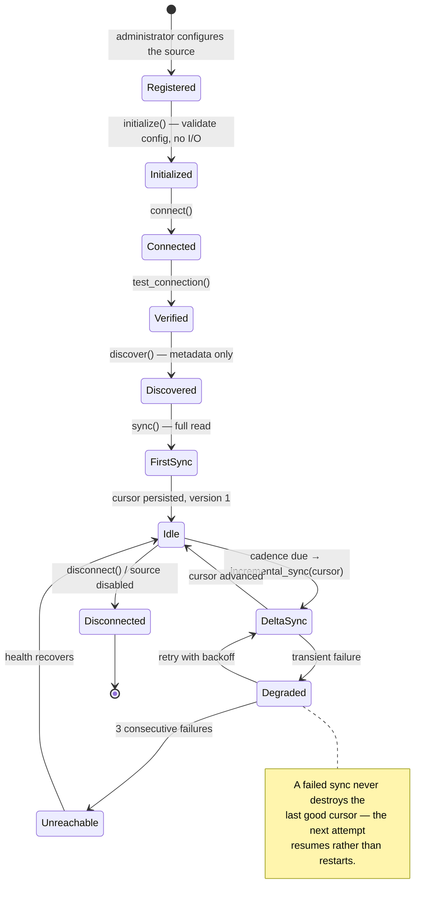
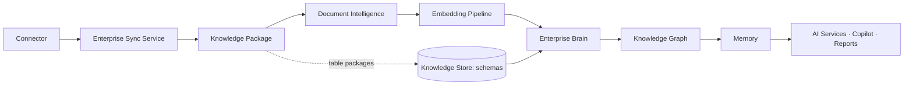
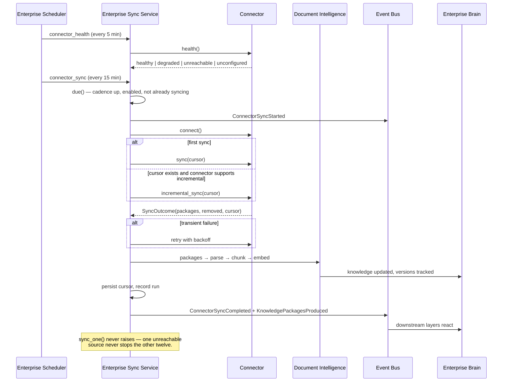
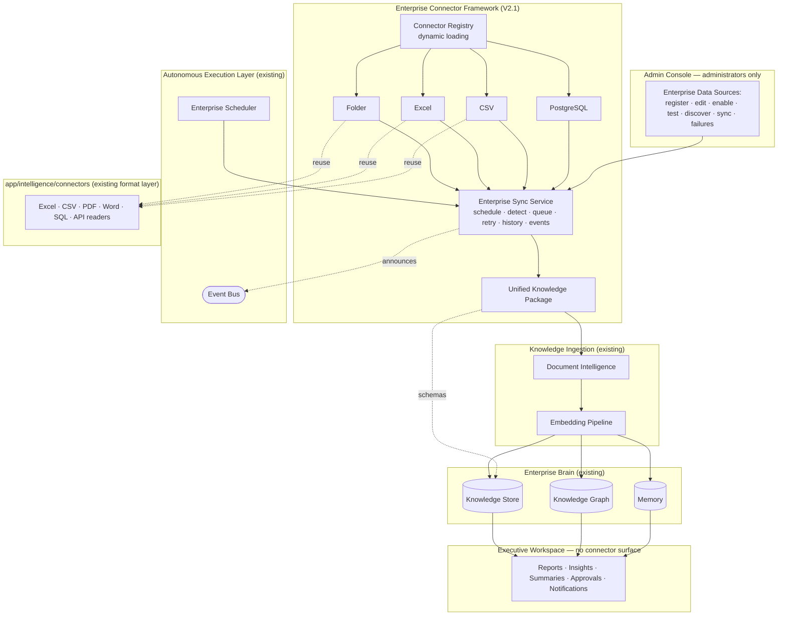

# Enterprise Connector Framework — Version 2.1

The Enterprise Brain learns from analyses. From V2.1 it also learns from the
**enterprise itself**, continuously.

An administrator configures a data source once. The Runtime synchronizes it
from then on. Every new document, spreadsheet, report, meeting note, or
database change becomes organizational knowledge automatically. **Managers
never upload a file and never configure a connector.**

This document covers the Enterprise Connector Layer, the Knowledge Ingestion
Pipeline, the Synchronization Flow, the Version 2 architecture, and the
Connector Lifecycle.

---

## 1. Why a framework, not four connectors

V2.1 ships four connectors. The point is the other twelve.

Every enterprise source needs the same things: configuration, credentials by
reference, scheduling, change detection, retries, health, history, events, and
normalization into whatever the Brain consumes. If each connector implements
those, the tenth connector is the tenth chance to get retry semantics subtly
wrong.

So the framework owns all of it, and a connector owns exactly one thing:
**reading its source**. That is why adding SharePoint later is one file.

```
Framework owns          Connector owns
──────────────          ──────────────
configuration           reading this source
scheduling              describing this source's items
change detection        this source's incremental strategy
retries + backoff
health tracking
sync history
event publication
ingestion routing
normalization contract
```

---

## 2. Enterprise Connector Layer

### Two layers of "connector", deliberately

The platform has had connectors since V1. They are a different thing, and
conflating them would have produced a second parsing implementation.

| | `app/intelligence/connectors` | `app/connectors` |
|---|---|---|
| Called | **format** connectors | **source** connectors |
| Scope | one file, right now | one configured system, over time |
| State | none | configuration, cursor, health, history |
| Input | a `Path` | a `ConnectorConfig` |
| Output | `SourceExtract` (tables) | `SyncOutcome` (Knowledge Packages) |
| Lifecycle | `extract()` | 10 lifecycle methods |

Source connectors **use** format connectors. `ExcelConnector` (source) calls
`ExcelConnector` (format) to find tables inside messy sheets, because that
problem is already solved.

### The interface

Every connector inherits `EnterpriseConnector` and implements:

| Method | Contract |
|---|---|
| `initialize()` | Validate configuration. **No I/O** — an unreachable source must still initialize, so it can be registered, shown in Admin, and retried later. |
| `connect()` | Prepare the connection. Idempotent. |
| `test_connection()` | Prove connectivity without a full sync. **Never raises** — Admin's button always gets an answer, not a 500. |
| `discover()` | Enumerate what the source holds. Metadata only, bounded, cheap — an administrator runs it interactively. |
| `sync(cursor)` | Full read. Every item becomes a Knowledge Package. |
| `incremental_sync(cursor)` | Delta since the cursor. Defaults to a full sync. |
| `fetch_metadata(item_id)` | Structured metadata for one item. |
| `fetch_content(item_id)` | Raw bytes for one item. |
| `health()` | Self-assessment, cheap enough to run every tick. |
| `disconnect()` | Release resources. Never raises. |

`incremental_sync` defaulting to `sync` is the design decision that keeps new
connectors small: a connector that cannot do better is **slower, not wrong**.
Connectors that can do better declare the `incremental` capability.

### Capabilities

A connector declares what it can actually do, so the API, scheduler, and UI
can reason about it without instantiating or connecting to anything:
`discover` · `incremental` · `content` · `deletions` · `test_connection`.

### Errors are typed, and say whether to retry

```python
ConnectorNotConfigured   transient = False   # a missing credential
ConnectorUnavailable     transient = False   # a missing dependency
ConnectionFailed         transient = True    # a dropped socket
SyncFailed               transient = True    # a failed read
```

Only the connector knows which is which, so transience is the connector's
judgement, not the service's.

---

## 3. Unified Knowledge Package

A folder of PDFs, a workbook's sheets, and a PostgreSQL table have nothing in
common at the source. They have everything in common by the time they reach
the Brain.

```python
KnowledgePackage(
    source_id, source_name, connector_type, item_id, location,
    family,            # document | table | record | message
    file_type, title, author, tags,
    created_date, modified_date, ingested_at,
    raw_content,       # in memory only — never persisted
    structured_metadata, records,
    checksum, version, permissions, size, project_id,
)
```

Identity is `(source_id, item_id)`, stable across syncs — which is what lets
the platform **version** a document rather than duplicating it every time its
folder is re-read.

`raw_content` is deliberately excluded from `describe()`: a package record is
metadata and a checksum, small enough to keep in sync history. Content flows
through the pipeline in memory.

---

## 4. Connector Registry

Kinds are registered by dotted path and loaded dynamically:

```python
CONNECTOR_PATHS = {
    "folder":     "app.connectors.folder:FolderConnector",
    "excel":      "app.connectors.excel:ExcelConnector",
    "csv":        "app.connectors.csv:CSVConnector",
    "postgresql": "app.connectors.postgres:PostgreSQLConnector",
}
```

A deployment can add its own without touching this repository:

```python
container.connector_framework.registry.load(
    "acme_erp", "acme.connectors.erp:AcmeERPConnector")
```

A kind whose module will not import is **not** an error — it is reported as
unavailable with the reason, exactly as the format-connector registry already
behaves. A missing optional driver degrades one connector, never the
catalogue. Planned connectors (SharePoint, Outlook, Teams, OneDrive, SQL
Server, Oracle, REST) appear in the catalogue as `planned` so administrators
can see the roadmap without reading the source.

---

## 5. Connector lifecycle



### Cursors: two mechanisms, because sources split cleanly in two

| Mechanism | Used by | Detects |
|---|---|---|
| `fingerprints` — content hash per item | folders, workbooks, CSV repositories | additions, updates, **and deletions**, with no cooperation from the source |
| `watermark` — a monotonic column | large databases | new and updated rows without re-reading the table to hash it |

Cursors are returned by the connector and persisted by the **service**, so a
connector stays a pure reader and stays stateless between runs.

**Change detection is by content hash, not modification time.** A file that is
touched but unchanged must not re-enter the pipeline; a file restored from
backup with an old timestamp must.

---

## 6. Knowledge Ingestion Pipeline



Everything on this path happens automatically. Nobody presses anything.

Routing is by package family:

- **document** packages → Document Intelligence, unchanged from V2. The
  framework adapts packages to the sync-delta shape that pipeline already
  consumes rather than modifying it, which is what keeps V2.1 additive.
- **table** packages → the package catalogue and the Knowledge Store as
  structural facts. Rows are *not* pushed into the document pipeline: the
  analytics layers read their own data through the Intelligence Engine, and
  duplicating that path would create a second source of truth.

**Ingestion failure never loses a sync.** If the pipeline fails, the run is
recorded as `degraded` with the error, and the cursor does **not** advance —
so the next run retries the same items rather than silently skipping them.

---

## 7. Synchronization flow



### Scheduled jobs — on the existing scheduler

The framework **does not build a second scheduler**. It registers on the one
the Runtime already owns:

| Job | Kind | Purpose |
|---|---|---|
| `connector_health` | interval (5 min) | Every source's own health assessment |
| `connector_sync` | interval (15 min) | Synchronize every due source |
| `connector_sync_boot` | startup | First synchronization after the runtime starts |
| `connector_full_sweep` | cron (02:15) | Nightly full re-read, so a missed change self-heals |

### Events

`ConnectorRegistered` · `ConnectorSyncStarted` · `ConnectorSyncCompleted` ·
`ConnectorSyncFailed` · `ConnectorHealthChanged` · `KnowledgePackagesProduced`

Modules announce; they never call each other. Adding a consumer never touches
the framework.

---

## 8. Version 2 architecture



The constraint the diagram encodes: **the Executive Workspace has no edge to
the connector framework.** Managers receive knowledge; they never configure
its plumbing.

---

## 9. Shipped connectors

### Folder

Monitors a local, shared (UNC), or synced directory. PDF · DOCX · PPTX ·
XLSX/XLSM · CSV/TSV · TXT · Markdown — the formats Document Intelligence
already parses. Anything else is ignored silently, because enterprise folders
contain noise and a connector that fails on an unknown file type never
finishes.

- new file → package, version 1
- updated file → package, next version, same key
- deleted file → key in `removed`, archived downstream

Hashing is streamed, so a 2 GB spreadsheet does not become 2 GB of RAM. Path
traversal outside the configured root is refused.

Options: `recursive`, `extensions`, `category` (`sop` · `rca` · `policy` ·
`meeting` · `product_document` · `document`), `tags`, `scope`.

### Excel

Sheets, hidden sheets, named ranges, merged regions, detected tables per
sheet, each table's header row, row and column counts, and column schema with
inferred types (`integer` · `decimal` · `text` · `boolean` · `datetime`).

**No analytics.** Structure only.

### CSV

Identical behaviour, minus the sheet dimension. Separator sniffing comes from
the existing format connector.

### PostgreSQL

Built on a generic `DatabaseConnector` (SQLAlchemy), so SQL Server and Oracle
land later as subclasses that change a title and a URL check — not as three
more implementations.

- schema discovery, table and view listing
- columns, types, nullability, defaults, primary keys, foreign keys, indexes
- row estimates from `pg_class.reltuples` (the planner's own statistic — free)
  rather than `COUNT(*)`, which a metadata sync should never run
- incremental sync by watermark column, configured per table or globally

Options: `schemas`, `tables`, `include_views`, `watermark_column`,
`watermarks`, `count_rows`.

---

## 10. Security

**Credentials are never stored.** A source carries an auth *reference* — the
name of an environment variable — resolved in memory at connect time and never
written to disk, returned by an API, or logged.

The framework refuses, at registration:

- a secret value in `auth` (`value`, `secret`, `password`, `token`, `url`,
  `connection_string`)
- a credentialed connection string pasted into `location`

Driver errors are scrubbed before they reach a log or the Admin console,
because SQLAlchemy puts the connection URL in some messages:

```
could not connect to postgresql://user:hunter2@db/prod
→ could not connect to $EDIP_WAREHOUSE_URL
```

---

## 11. Administration

Admin Console → **Enterprise Data Sources** (`/admin/data-sources`).

| Method | Path | Description |
|---|---|---|
| GET | `/connectors` | Overview: sources, health, catalogue |
| GET | `/connectors/catalogue` | Available, unavailable, and planned kinds |
| GET | `/connectors/sources` | Every configured source (credentials never included) |
| POST | `/connectors/sources` | Register |
| GET | `/connectors/sources/{id}` | One source with runs, failures, packages |
| PATCH | `/connectors/sources/{id}` | Edit · enable · disable |
| DELETE | `/connectors/sources/{id}` | Disconnect (ingested knowledge is kept) |
| POST | `/connectors/sources/{id}/test` | Test connection |
| POST | `/connectors/sources/{id}/discover` | What is in there |
| POST | `/connectors/sources/{id}/health` | Check health now |
| POST | `/connectors/sources/{id}/sync` | Manual sync (`?full=true`) |
| POST | `/connectors/sync` | Manual sync of every enabled source |
| GET | `/connectors/runs` | Sync history |
| GET | `/connectors/failures` | Failures with errors and attempt counts |
| GET | `/connectors/packages` | Knowledge Package catalogue |

Deleting a source removes its configuration and sync state. It does **not**
delete knowledge already ingested from it — that is a separate, audited
decision, not a side effect of unplugging a cable.

---

## 12. Adding a connector

```python
from app.connectors.base import (
    Discovery, DiscoveredItem, EnterpriseConnector, SyncCursor, SyncOutcome,
)
from app.connectors.package import KnowledgePackage


class SharePointConnector(EnterpriseConnector):
    kind = "sharepoint"
    title = "SharePoint"
    description = "SharePoint document libraries."
    capabilities = ("discover", "incremental", "content", "deletions",
                    "test_connection")
    produces = "documents"

    def discover(self) -> Discovery: ...
    def fetch_metadata(self, item_id: str) -> dict: ...
    def sync(self, cursor: SyncCursor | None = None) -> SyncOutcome: ...
```

Then one line in `CONNECTOR_PATHS`. Nothing else in the platform changes: not
the scheduler, not the event bus, not the ingestion pipeline, not the Brain,
not the API, not the Admin console.

That is the deliverable.

---

## 13. Configuration

| Setting | Default | Meaning |
|---|---|---|
| `EDIP_CONNECTORS_ENABLED` | `true` | Off = registry and manual sync still work; automatic synchronization stops |
| `EDIP_CONNECTOR_SYNC_INTERVAL_SECONDS` | `900` | Due-source synchronization cadence |
| `EDIP_CONNECTOR_HEALTH_INTERVAL_SECONDS` | `300` | Health assessment cadence |
| `EDIP_CONNECTOR_SWEEP_CRON` | `15 2 * * *` | Nightly full re-read |

State lives under `data/connectors`: `connectors.json`, `runs.json`,
`packages.json`, `failures.json`, and `cursors/`.

---

## 14. Backward compatibility

V2.1 is **additive**. The V2 Synchronization Layer (`app/sync`), its data
source registry, its sync engine, and the Document Intelligence pipeline are
unchanged and continue to run. The connector framework is a second, more
general path into the same ingestion pipeline, and either can be disabled
independently. No existing API, artifact, or stored record changed shape.
