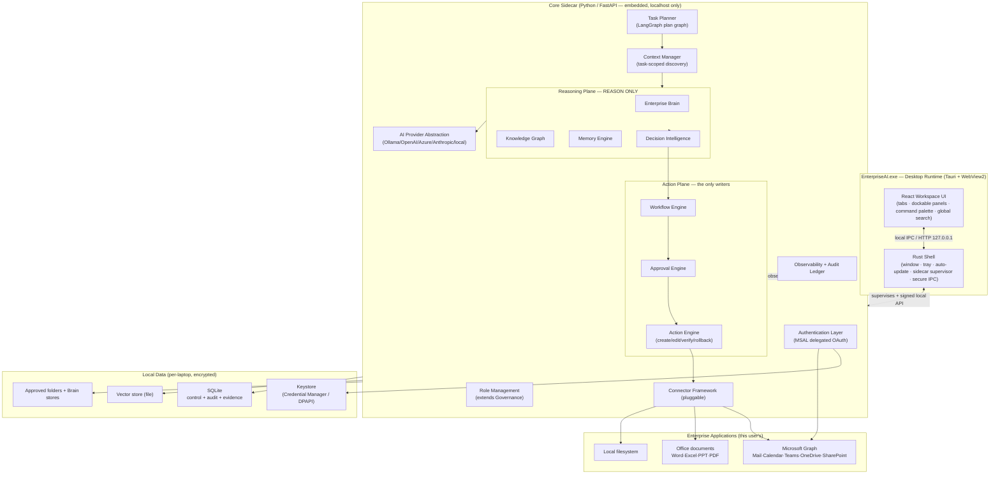

# 01 — System Architecture

> Deliverables covered: **#1** production architecture · **#2** folder structure · **#3**
> module responsibilities · **#6** component diagram · **#8** technology stack.

---

## 1. The core layering (the required stack, made concrete)

The brief specifies a layered stack. Below, each layer names the **concrete
implementation** and whether it is **reused** from the existing codebase or **new** in
v4. "Reused" means the module exists today and is retained (possibly repositioned);
"new" means a v4 subsystem, most of which is a thin orchestration over existing
registries.

| # | Layer | Implementation | Origin |
|---|-------|----------------|--------|
| 1 | **Enterprise Desktop Runtime** | `desktop/` — Tauri (Rust) shell + WebView2 UI; spawns and supervises the Python **Core sidecar** | **new** |
| 2 | **Authentication Layer** | `core/app/identity/` — MSAL delegated OAuth, token cache in Windows Credential Manager / DPAPI | **new** (wraps existing `communication/graph.py` auth stub) |
| 3 | **Role Management** | `core/app/roles/` — role profiles; **extends** `app/governance` (RBAC, permissions already exist) | **new + reuse** |
| 4 | **Task Planner** | `core/app/planner/` — intent→plan; **reuses** `app/runtime/planning.py`, `app/orchestration` (LangGraph), `app/agents/reasoning.py` | **new + reuse** |
| 5 | **Context Manager** | `core/app/context/` — task-scoped discovery; **reuses** `app/sync/search.py`, `app/copilot/context.py`, embeddings | **new + reuse** |
| 6 | **Enterprise Brain** | `app/brain/` — reasoning/summarization/understanding | **reused, repositioned** |
| 7 | **Knowledge Graph** | `app/knowledge/graph.py` (`EnterpriseKnowledgeGraph`) — business-entity graph | **reused** |
| 8 | **Memory Engine** | `app/memory/` (`MemoryManager`, `MemoryLifecycle`, `MemorySynchronizer`) | **reused, extended** |
| 9 | **Decision Intelligence** | `app/runtime/intelligence.py` + `app/runtime/decisions.py` + `app/executive/` | **reused** |
| 10 | **Action Engine** | `core/app/actions/` — the only writer to Outlook/Office/files; typed reversible actions | **new** (extends `app/copilot/actions.py`, `app/tools/planned.py`) |
| 11 | **Workflow Engine** | `app/workflows/engine.py` + `registry.py` — **extended** with compensation/parallel/HITL | **reused, extended** |
| 12 | **Approval Engine** | `core/app/approvals/` — **extends** `app/governance/policies.py` + `app/runtime/queue.py` approval gate | **new + reuse** |
| 13 | **Connector Framework** | `app/connectors/` (`EnterpriseConnectorFramework`) — **extended** with Graph + Office connectors | **reused, extended** |
| 14 | **Enterprise Applications** | Outlook, Teams, Calendar, OneDrive, SharePoint, Word, Excel, PowerPoint, PDF, local FS | external |

**The invariant (P1/P2):** control flows *down* through Planner → Context → Brain →
Decision Intelligence to produce a **plan of evidence-backed Actions**, then *down* again
through the Workflow + Approval Engines to the Action Engine, which is the *sole* writer
to the Enterprise Applications. The Brain never appears below the Action Engine — it
cannot reach Outlook, Excel, or the filesystem.

---

## 2. Component diagram (C4 container level)



**Two processes, one app.** The Rust **Shell** owns the window, OS integration,
auto-update, and secrets brokering; the Python **Core sidecar** hosts the entire existing
backend plus the v4 engines, bound to `127.0.0.1` on a random port with a per-launch
bearer token. This keeps the mature Python intelligence intact (ADR-001) while giving
users a native, browser-free experience (ADR-002).

---

## 3. The three planes (control / reason / act)

v4 preserves v3's plane separation but re-expresses it for a single-user device:

| Plane | Responsibility | Stores | Never does |
|-------|----------------|--------|------------|
| **Control** | Identity, roles, runs, evidence ledger, audit, approvals, config | SQLite (`control.db`), keystore | Reason; act |
| **Reason** | Brain, graph, memory, decision intelligence, planning, LLM narration | knowledge/, vector store, memory/ | Write to user apps |
| **Act** | Action Engine, Workflow Engine, connectors | audit ledger (writes recorded) | Invent facts (must cite evidence) |

A single Action's lifecycle touches all three: the **Reason** plane decides *what* and
supplies evidence; the **Control** plane authorizes it (role + approval policy) and
records it; the **Act** plane performs it and verifies the post-condition.

---

## 4. Module responsibilities (deliverable #3)

### 4.1 New v4 subsystems

| Module | Responsibility | Key collaborators |
|--------|----------------|-------------------|
| `desktop/` (Rust) | Native shell, window/tray, auto-update, sidecar lifecycle, secrets broker, deep-links | WebView2, Core sidecar |
| `core/app/identity/` | MSAL delegated OAuth per user; token acquisition/refresh; scope management; sign-in/out | Windows Credential Manager, MS Graph |
| `core/app/roles/` | Load role profile (PM/BA/Data/Finance/HR/Ops/Leadership/Compliance/Support): its workflows, tool allow-list, prompts, dashboards, approval policy | Governance, Workflow Registry, Prompt Registry |
| `core/app/context/` | **Task-scoped discovery** — resolve intent to the *minimal* set of emails, chats, meetings, workbooks, prior reports, and docs needed; rank; load; nothing else | Connector Framework, search, embeddings, Memory |
| `core/app/planner/` | Understand intent → decompose into steps → estimate resources → select connectors → emit an executable **Plan** (DAG of Actions/Workflows) | Reasoning, Decision Intelligence, LangGraph |
| `core/app/actions/` | Execute typed Actions against apps; capture pre-image; verify post-condition; **rollback**; version | Connectors, Office adapters, audit ledger |
| `core/app/approvals/` | Evaluate approval policies; pause plans at HITL gates; surface approval requests to UI | Governance policies, Workflow Engine, Runtime queue |
| `core/app/office/` | Document Intelligence writers/readers for Word/Excel/PPT/PDF (formatting-preserving edits, track changes, pivots, charts) | Action Engine, `openpyxl`/`python-docx`/`python-pptx` |

### 4.2 Retained services (repositioned as internal capabilities)

| Module (existing) | Retained responsibility | v4 change |
|-------------------|-------------------------|-----------|
| `app/brain/` | Reasoning, planning support, summarization, recommendations, business + document understanding | **No longer the top-level product**; called by Planner/Context; forbidden from side-effects (already true) |
| `app/knowledge/graph.py` | Business-entity graph (products, projects, meetings, employees, docs, KPIs, merchants, incidents, tasks, emails, relationships) | Shift emphasis from documents to **business entities** (already begun in V3.1 `build_business_graph`); default store stays file-backed NetworkX, Neo4j optional |
| `app/memory/` | Recent files, conversations, reports, entities, preferences, current task, prior executions | **Extend** with desktop-specific memory (recent files, active task) — see [06](06-brain-services-and-intelligence.md) §3 |
| `app/runtime/intelligence.py`, `runtime/decisions.py`, `app/executive/` | Priority scoring, risk, impact, confidence, approval suggestion, recommendations | Feeds the **Approval Engine** (confidence→approval routing already exists) |
| `app/connectors/` | Pluggable connector registry + framework, folder/excel/csv/db connectors | **Extend** with Graph + Office; already designed for pluggability |
| `app/workflows/` | Workflow engine + registry, retry, autonomous cadences | **Extend**: parallel, conditional, compensation, HITL nodes |
| `app/governance/` | RBAC, connector permissions, approval + retention policies, audit | Underpins Role Management + Approval Engine |
| `app/runtime/` | Scheduler, event bus, action queue, triggers, goals — the heartbeat | Retained as the local automation heartbeat; queue approval-gate becomes Approval Engine's transport |
| `app/llm/` | Provider abstraction (Ollama/OpenAI/Azure/Anthropic/Gemini/mock/enterprise) | Retained as-is; default provider on-device (Ollama/local) |
| `app/observability/`, `app/evidence/`, `app/evaluation/` | Status dashboard, evidence ledger, output evaluation | Retained; observability composes each layer's `status()` |
| `app/documents/`, `app/intelligence/` | Parse/chunk/embed pipeline; profiling/semantics/forecasting/quality | Retained; read-side of Document Intelligence |

### 4.3 What is retired

- The **shared web deployment assumptions** (CORS origins, multi-tenant Postgres as the
  primary control plane, Redis/Celery as required infra). These become *optional* in the
  desktop profile (SQLite + in-process scheduler), and remain available for the optional
  central-fleet profile (see [08](08-delivery-migration-readiness.md) §5).
- The **Synthetic Enterprise Generator** (`generate_enterprise.py`, `app/executive`
  reading `enterprise_data/`) is **not** shipped in the employee build. It moves to a
  `tools/demo/` developer/QA package used for testing and sales demos only (ADR-010).

---

## 5. Technology stack (deliverable #8)

| Concern | Choice | Why (ADR) |
|---------|--------|-----------|
| Desktop shell | **Tauri 2 (Rust)** + WebView2 | ~10 MB shell vs Electron's ~150 MB; uses the OS WebView already on Win 11; native secrets/updater; smaller attack surface (ADR-002) |
| UI | **React 18 + Vite** (existing `frontend/`) restyled into a desktop workspace | Reuse the entire existing component library; no rewrite (ADR-003) |
| Core runtime | **Python 3.11 + FastAPI** (existing `backend/`) as an embedded sidecar | Reuse 38k lines of tested intelligence unchanged (ADR-001) |
| Sidecar packaging | **PyInstaller** one-folder, bundled with the Tauri app | Deterministic, offline, no system Python dependency |
| Orchestration | **LangGraph** (already integrated, `orchestrator=langgraph`) for plan graphs; imperative fallback retained | Checkpointing + `interrupt()` = native HITL (ADR-006) |
| Control + audit + evidence | **SQLite** (`control.db`, WAL mode) | Already the lite-profile default; zero-admin, single-file, encryptable |
| Vector store | **file-backed / sqlite-vec** (embedding_dim configurable) | Lite profile already ships file vectors; pgvector optional for fleet profile |
| Knowledge graph | **NetworkX file store** (existing) with **Neo4j optional** | Per-laptop scale needs no graph server (ADR-008) |
| Identity | **MSAL for Python** (delegated OAuth, PKCE) | Microsoft-recommended; no password handling (ADR-004) |
| Secret storage | **Windows Credential Manager** via keyring + **DPAPI** for at-rest blobs | OS-native, per-user, hardware-tied (ADR-005) |
| Office I/O | `openpyxl` (Excel), `python-docx` (Word), `python-pptx` (PPT), `pypdf`/`pdfplumber` (PDF) | Server-side, no Office install required; COM automation optional add-in |
| AI providers | Existing provider abstraction; **Ollama/local default**, cloud opt-in | On-device by default = privacy + offline (P4) |
| Packaging/installer | **WiX / MSIX** signed installer; Tauri updater for deltas | Enterprise deployment via Intune/SCCM (ADR-011) |
| Telemetry | OpenTelemetry → local file; optional OTLP export to fleet endpoint | Off-device telemetry is opt-in only (P4) |

---

## 6. Folder structure (deliverable #2)

The repository becomes a **workspace** with the desktop shell, the Python core (the
existing `backend/` restructured additively), and shared installer assets. **Existing
paths are preserved** — v4 modules are added, not moved, honouring the additive-layer
convention.

```
enterprise-ai/
├─ desktop/                         # NEW — Tauri shell (Rust) → EnterpriseAI.exe
│  ├─ src-tauri/
│  │  ├─ src/
│  │  │  ├─ main.rs                 # window, tray, single-instance, deep-links
│  │  │  ├─ sidecar.rs              # spawn/supervise/health-check Core, random port + token
│  │  │  ├─ secrets.rs              # Credential Manager / DPAPI broker
│  │  │  ├─ updater.rs              # signed delta auto-update
│  │  │  └─ ipc.rs                  # typed commands bridging UI ⇄ Core
│  │  ├─ tauri.conf.json            # bundle, updater, CSP, capabilities
│  │  └─ icons/
│  └─ resources/                    # bundled PyInstaller Core, default config, models
│
├─ frontend/                        # EXISTING React app — restyled as the workspace
│  └─ src/
│     ├─ shell/                     # NEW — tabs, dock manager, command palette, tray views
│     ├─ pages/                     # existing pages retained (Cockpit, Copilot, Graph…)
│     ├─ workspace/                 # NEW — role dashboards, task inbox, approval center
│     └─ components/                # existing premium.jsx etc.
│
├─ backend/                         # EXISTING Python core — additive v4 packages
│  └─ app/
│     ├─ identity/                  # NEW — MSAL auth, token cache, scopes
│     ├─ roles/                     # NEW — role profiles, dashboards, allow-lists
│     ├─ planner/                   # NEW — Task Planner (LangGraph plan graph)
│     ├─ context/                   # NEW — Context Manager (task-scoped discovery)
│     ├─ actions/                   # NEW — Action Engine (typed, reversible writes)
│     ├─ approvals/                 # NEW — Approval Engine (policy + HITL transport)
│     ├─ office/                    # NEW — Word/Excel/PPT/PDF write adapters
│     ├─ brain/          ┐
│     ├─ knowledge/      │
│     ├─ memory/         │  EXISTING reasoning services — retained, repositioned
│     ├─ executive/      │
│     ├─ runtime/        │  (scheduler, events, queue, decisions, intelligence, planning)
│     ├─ connectors/     │  EXTENDED with graph.py, outlook.py, teams.py, onedrive.py…
│     ├─ workflows/      │  EXTENDED with parallel/conditional/compensation/HITL
│     ├─ governance/     │
│     ├─ llm/            │
│     ├─ observability/  │
│     ├─ intelligence/   │
│     ├─ documents/      ┘
│     ├─ core/                      # config.py (EDIP_*), container.py (DI root), logging
│     ├─ api/v1/                    # existing REST + NEW planner/actions/approvals/roles
│     └─ main.py                    # FastAPI app (now bound to 127.0.0.1 in desktop mode)
│
├─ installer/                       # NEW — WiX/MSIX, signing, first-run wizard assets
├─ tools/
│  └─ demo/                         # MOVED — generate_enterprise.py + synthetic corpus (dev/QA only)
├─ docs/
│  ├─ architecture-v3/              # prior web-platform design (retained)
│  └─ architecture-v4/              # THIS set
└─ tests/                           # existing 572+ backend tests + new engine/connector suites
```

The **DI container** (`backend/app/core/container.py`) remains the single composition
root: v4 wires the new engines into it in dependency order (identity → roles → context →
planner → actions → approvals), each behind an `EDIP_*_ENABLED` flag, exactly as V2.1–
V3.1 layers were added.

Continue to [02-desktop-runtime-and-packaging.md](02-desktop-runtime-and-packaging.md).
