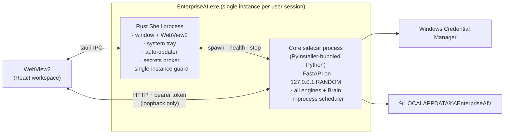
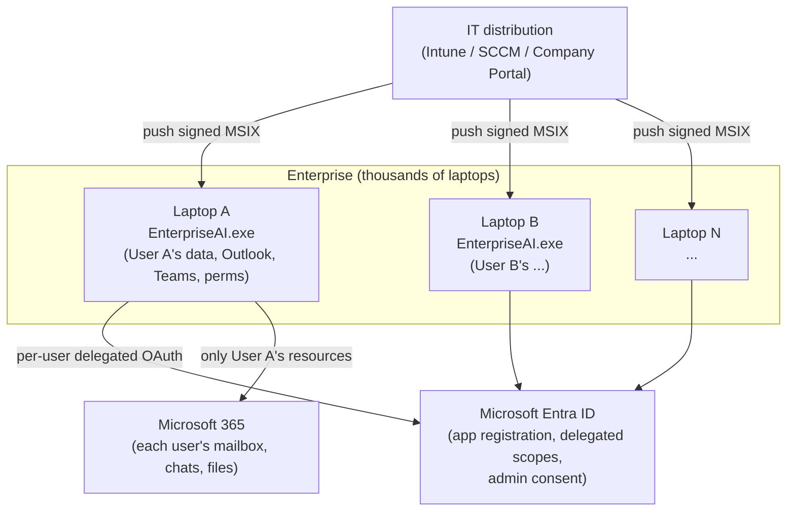
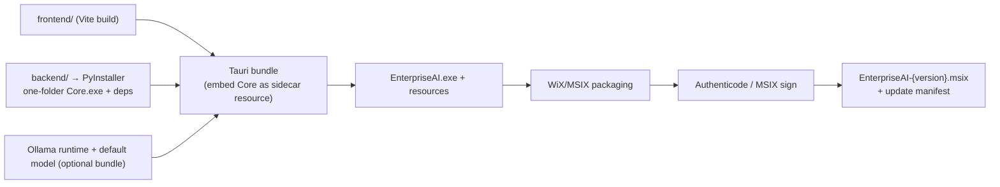

# 02 — Desktop Runtime, Deployment & Packaging

> Deliverables covered: **#10** desktop runtime architecture · **#18** deployment
> architecture · **#19** packaging strategy.

---

## 1. Process model

`EnterpriseAI.exe` is **one application, two supervised processes**:

**Why two processes.** The Shell is small, native, and always responsive (it can show a
splash, a crash dialog, or a "Core restarting…" state even if Python hangs). The Core is
the existing FastAPI backend, unmodified in its internals, launched as a child process.
The Shell supervises the Core: it starts it on a random loopback port with a per-launch
bearer token, health-checks `/health`, restarts it with backoff on crash, and kills it on
exit. This is the standard Tauri "sidecar" pattern and isolates the mature Python
codebase behind a process boundary (ADR-001).

**Binding & isolation.** The Core binds `127.0.0.1` only — never a routable interface. It
requires the per-launch bearer token on every request (rejecting any request without it,
which blocks other local processes and CSRF-style attacks from a browser). CORS is
restricted to the Tauri WebView origin. No inbound network listener is exposed.

**Lifecycle.**

| Event | Shell behaviour | Core behaviour |
|-------|-----------------|----------------|
| Launch | single-instance check → splash → spawn Core → wait for `/health` ok | build DI container, run migrations, `runtime.start()` |
| Second launch | focus existing window, exit | — |
| Core crash | detect via health probe / exit code → show banner → restart (exp. backoff, max N) | crash-recovery: resume from persisted store (see §3.3) |
| Sleep/resume | pause polling; re-probe Core on resume | scheduler catches up missed jobs (idempotent) |
| Quit | signal Core graceful stop (drain in-flight actions), then exit | flush audit ledger, checkpoint plans, stop scheduler |
| Update | download delta → verify signature → stage → relaunch | — |

---

## 2. In-process runtime (what runs inside the Core)

The Core reuses the existing `AutonomyRuntime` heartbeat (`app/runtime/runtime.py`) —
scheduler, event bus, action queue, triggers, goals, planning — as the **local automation
engine**. On a laptop this replaces Celery/Redis entirely:

- **Scheduler** (`EnterpriseScheduler`) ticks in-process (`autonomy_tick_seconds`),
  running due jobs: connector sync, knowledge refresh, decision sweeps, drafting
  cadences. All jobs are **idempotent** and cron-catch-up safe, so laptop sleep/offline
  gaps are harmless.
- **Event bus** (`EventBus`) is the in-process pub/sub the whole platform already uses;
  no message broker required.
- **Action queue** (`ActionQueue`) already implements the approval gate
  (`autonomy_requires_approval`) — v4's Approval Engine plugs into it as the transport.
- **Offline tolerance:** every store is disk-backed (SQLite + JSON stores under
  `data_dir`), read fresh per operation. When Graph/network is unavailable, connectors
  report unhealthy and queued external Actions **wait** (exactly the existing behaviour
  for unconfigured channels) — nothing is lost.

Config already supports this directly: `use_celery: false`, `redis_url` unused,
`database_url` empty → SQLite, `vector_backend: memory/file`, `llm_provider: ollama`.
**The desktop profile is the existing lite profile.**

---

## 3. Reliability & crash recovery

### 3.1 Durable-by-construction
Every stateful subsystem persists to disk *before* acting and reads fresh: runs/evidence/
audit in SQLite (WAL), runtime state as JSON under `data_dir/runtime`, plans checkpointed
by LangGraph. There is no in-memory-only critical state.

### 3.2 Action journaling (the core of safe automation)
Before the Action Engine performs any write it appends a **journal entry** (intended
action + captured pre-image) to the audit ledger, and marks it `committed` only after the
post-condition verifies. On restart the Core scans for `in-flight` journal entries and
either completes verification or **rolls back** using the pre-image (see
[04](04-context-planner-action.md) §3.4). This makes a mid-edit crash on a user's
`.xlsx` non-destructive.

### 3.3 Supervised restart
The Shell restarts a crashed Core with exponential backoff. The Core resumes: pending
approvals remain pending, checkpointed plans resume at their last node, the scheduler
catches up missed crons. The user sees a transient "reconnecting" banner, not data loss.

### 3.4 Watchdogs & health
`/health` returns each layer's `status()` (the existing observability composition). The
Shell surfaces degraded state (e.g., "Microsoft sign-in expired", "AI provider
unreachable") in the tray and a diagnostics panel.

---

## 4. Deployment architecture (deliverable #18)

### 4.1 v1 — independent per-laptop installs (required)

- **No central server, no shared database.** Each install is fully independent and
  operates on local resources plus the M365 resources *that user* is authorized for.
- **One-time enterprise setup:** an Entra ID **app registration** (single tenant),
  declaring the delegated Graph scopes, with **admin consent** granted once by IT. Each
  user then signs in individually; the app never sees passwords (ADR-004).
- **Distribution:** IT pushes the signed MSIX via Intune/SCCM. Config defaults (allowed
  folders, AI provider, telemetry opt-in) can be seeded by an MSI transform / registry
  policy / `machine-config.json` dropped by GPO.

### 4.2 v2+ — optional central control plane (designed for, not required)

For fleets wanting central policy, telemetry, and shared knowledge, the same Core can
point at shared infrastructure by **configuration only** (the code already supports it):
`EDIP_DATABASE_URL` → Postgres, `EDIP_PGVECTOR_URL`, `EDIP_NEO4J_URI`,
`EDIP_MLFLOW_URI`, OTLP telemetry export, a central Governance policy source. See
[08](08-delivery-migration-readiness.md) §5. This is a deployment toggle, not a second
product.

---

## 5. Packaging strategy (deliverable #19)

### 5.1 Build pipeline

- **Core** is frozen with PyInstaller (one-folder for fast startup and antivirus
  friendliness) and embedded as a Tauri **sidecar binary**. No system Python is required
  on the target laptop.
- **AI model:** default is on-device (Ollama). The installer offers *bundle model
  offline* (larger installer) or *download on first run* (smaller). Cloud providers are
  config opt-in.
- **Signing:** the shell, the sidecar, and the installer are all **Authenticode-signed**
  (EV cert) so SmartScreen/AV trust them and Intune can validate them.
- **Reproducible builds:** pinned Python + Node lockfiles, pinned Rust toolchain, CI
  produces byte-stable artifacts with an SBOM (CycloneDX) for supply-chain audit.

### 5.2 Installer & first-run

| Stage | What happens |
|-------|--------------|
| Install (silent-capable) | MSIX/MSI to `%LOCALAPPDATA%`; per-user, no admin required for the app itself; registers auto-start (optional), file associations, deep-link protocol |
| First-run **Configuration Wizard** | (1) Welcome + license → (2) **Microsoft sign-in** (MSAL) → (3) **Permission configuration** (which Graph scopes/roles) → (4) **Folder selection** (approved local folders only) → (5) **AI provider** (on-device default / enterprise endpoint) → (6) **Role selection** (PM/BA/Finance/…) → seed local stores |
| Steady state | Auto-update checks; token silent-refresh; scheduler runs |

Wizard choices are written to the encrypted local config; **no folder is scanned and no
mailbox is read until the user has explicitly granted it.**

### 5.3 Auto-update

Tauri's updater pulls a **signed** delta manifest from an enterprise-hosted (or vendor)
endpoint; signature + version are verified before staging; update applies on next
relaunch. IT can pin/stage versions via Intune. Rollback: the prior version folder is
retained for one generation.

---

## 6. Configuration & data locations

| Path | Contents | Protection |
|------|----------|------------|
| `%PROGRAMFILES%\EnterpriseAI\` or per-user MSIX store | binaries (read-only) | signed |
| `%LOCALAPPDATA%\EnterpriseAI\data\` | SQLite control+audit, knowledge/, memory/, vector store, runtime state | DPAPI-encrypted stores; NTFS ACL to the user |
| Windows Credential Manager | MSAL token cache, AI API keys, DB creds (fleet mode) | OS keystore, per-user |
| `%LOCALAPPDATA%\EnterpriseAI\config\` | wizard config, role profile, approved folders, telemetry opt-in | DPAPI |
| `%LOCALAPPDATA%\EnterpriseAI\logs\` | rotating logs, OTel spans (local) | ACL to user |

Machine-wide policy overrides (`machine-config.json` via GPO/Intune) are read-only and
take precedence over user config for locked-down settings (e.g., forbidden folders,
mandatory approval policies).

Continue to [03-security-and-auth.md](03-security-and-auth.md).
