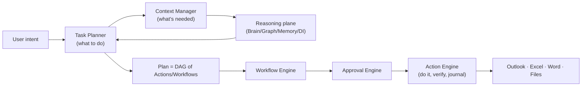
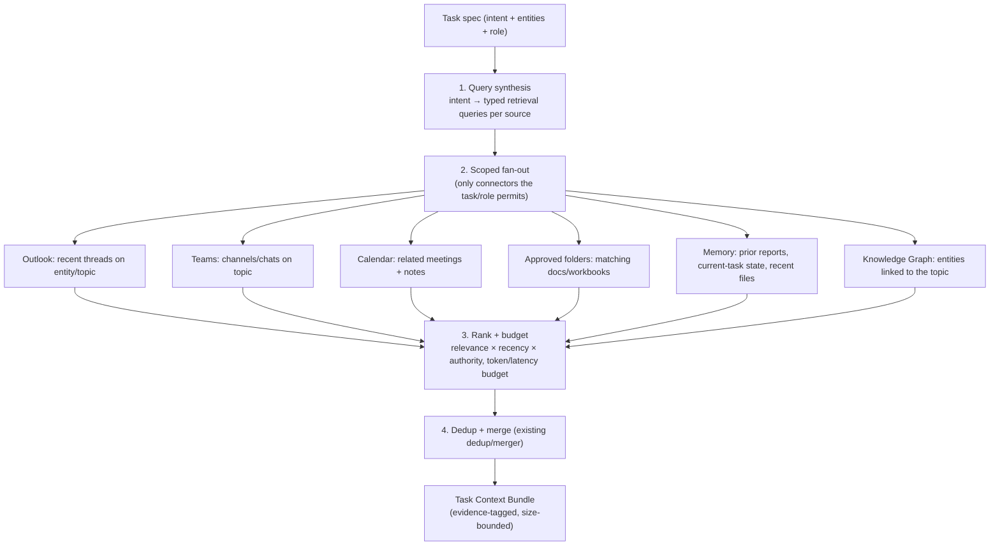
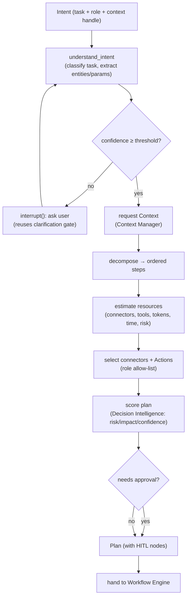
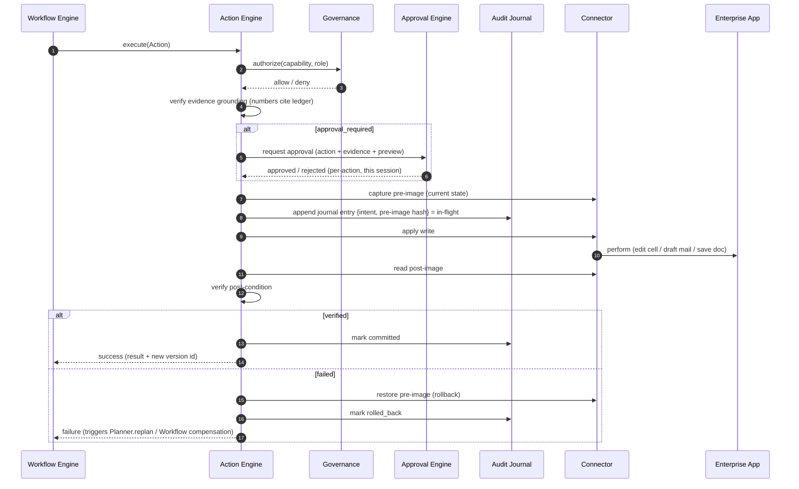

# 04 — Context Manager, Task Planner & Action Engine

> Deliverables covered: **#12** Context Manager · **#13** Planner · **#14** Action Engine.

These three subsystems are the heart of "do work, not just answer." They sit between the
user's intent and the enterprise applications, and they enforce P1 (reason ≠ act) and P2
(every side-effect is a planned, verifiable, reversible Action).

The end-to-end control flow for a task like *"Update the Weekly Report"*:



---

## 1. Context Manager (deliverable #12)

**Purpose.** Discover *only* the information the current task needs — never index the
whole PC. It answers: "to do *this* task, which emails, chats, meetings, workbooks,
prior reports, and documents are relevant, and nothing more?"

**Reuses:** `app/sync/search.py` (unified enterprise search + the `documents` surface),
`app/copilot/context.py` + `app/copilot/evidence.py` (context assembly + evidence
grounding already built for the Copilot), the embedder and vector store, and the Memory
Engine.

### 1.1 Discovery pipeline



### 1.2 Design principles

- **Task-scoped, not global.** Discovery starts from the task's entities/topic (resolved
  via the Knowledge Graph and Memory), not a full-disk crawl. The only local files
  searched are in **approved folders**, and only those matching the query.
- **Pull, ranked, budgeted.** Each source returns candidates; a single ranker scores by
  relevance × recency × source authority and fills a **context budget** (token + latency
  cap). Low-value items are dropped, not loaded.
- **Evidence-tagged output.** Every item enters the bundle as an Evidence Ledger record
  (id, source, snippet, numbers) so anything the LLM later says about it is grounded and
  verifiable — reusing the existing evidence contract.
- **Incremental & cached.** Discovery results and embeddings are cached keyed by
  corpus/source mtime (the pattern `EnterpriseReader` already uses), so repeated tasks on
  the same entities are fast and re-ingest is auto-detected.
- **Permission-aware.** A source the user's role or OAuth scope can't reach is silently
  skipped, not errored.

### 1.3 Interface

```python
class ContextManager:
    def discover(self, task: TaskSpec, budget: ContextBudget) -> TaskContext: ...
    def refine(self, task: TaskSpec, feedback: str) -> TaskContext: ...   # after clarification
    def status(self) -> dict: ...   # sources queried, items kept/dropped, cache hits
```

`TaskContext` = ordered, evidence-tagged items + resolved entities + source health. It is
the *only* thing the Planner hands to the reasoning plane — the Brain never reaches back
out to connectors itself (P1).

---

## 2. Task Planner (deliverable #13)

**Purpose.** Before anything executes: understand intent → break into steps → estimate
resources → determine required connectors → build an executable plan → delegate. The
Planner is the orchestrator; nothing else decides *what happens*.

**Reuses:** `app/orchestration` (LangGraph — checkpointing, `interrupt()` for HITL),
`app/runtime/planning.py` (`PlanningEngine`, goals→plans already exists),
`app/agents/reasoning.py` + `PlannerAgent`, Decision Intelligence for scoring, and the
existing clarification-gate pattern (`clarification_confidence_threshold`).

### 2.1 Planning graph



### 2.2 What a Plan is

A **Plan** is a DAG whose nodes are typed **Steps**; each Step resolves to either a
reasoning call (Brain/DI), a single **Action** (Action Engine), or a sub-**Workflow**.
Each Step carries: inputs (evidence ids from context), the connector/tool + capability it
needs, an estimated cost/risk, a required-role/permission, and an `approval_required`
flag (from role policy + Decision Intelligence confidence). Plans are **checkpointed**
(LangGraph) so they survive restart and support HITL `interrupt()`/resume.

Worked example — *"Update the Weekly Report"* decomposes to:

1. `discover_context` → related emails, Teams updates, the KPI workbook, last week's report.
2. `read_workbook` (Excel connector) → current figures as evidence.
3. `summarize_changes` (Brain) → narrative grounded in evidence.
4. `draft_report` (Action: Word/generate) → new revision, formatting preserved, changes tracked.
5. `verify` (Action: verify) → figures in the doc match the evidence ledger.
6. `draft_email` (Action: Outlook/draft) → status mail, **approval-gated** before send.

### 2.3 Interface

```python
class TaskPlanner:
    def plan(self, intent: Intent, role: RoleProfile) -> Plan: ...
    def replan(self, plan: Plan, failure: StepFailure) -> Plan: ...   # on Action failure
    def status(self) -> dict: ...
```

The Planner **estimates before executing** (resource/risk), so the UI can show the user
"this will read 12 emails and the KPI workbook, and draft (not send) 1 email" *before*
anything runs — consent by preview.

---

## 3. Action Engine (deliverable #14)

**Purpose.** The **only** component that writes to the enterprise applications: create,
edit, move, rename, delete, version, update, export, generate, verify, rollback. It is
completely separate from reasoning (P1) and makes every side-effect journaled,
verifiable, and reversible (P2).

**Reuses & extends:** `app/copilot/actions.py`, `app/tools/planned.py` (Email/Calendar/
PowerPoint/PDF tool stubs already exist), the connector framework, and the audit ledger.

### 3.1 The typed Action

```python
@dataclass(frozen=True)
class Action:
    kind: ActionKind          # CREATE|EDIT|MOVE|RENAME|DELETE|VERSION|UPDATE|
                              # EXPORT|GENERATE|SEND|VERIFY
    target: ResourceRef       # connector + resource (e.g. excel://…#Sheet1!B2)
    payload: dict             # what to write (values, text, slide, recipients…)
    evidence: list[str]       # Evidence Ledger ids justifying the payload
    capability: str           # governance capability required
    reversible: bool
    approval_required: bool
```

An Action is a **request**, not an effect. The engine turns it into an effect only after
authorization, journaling, and (for gated kinds) approval.

### 3.2 Execution pipeline



### 3.3 Safety properties

- **Pre-image capture + rollback.** Before editing a workbook cell, renaming a file, or
  changing a doc, the engine snapshots the prior state (value, file bytes, or a version).
  On failure or user undo, it restores it. Destructive kinds (`DELETE`) soft-delete to a
  recoverable quarantine first.
- **Post-condition verification.** After the write, the engine re-reads and asserts the
  intended state (the cell holds the expected value; the doc contains the section). A
  write that "succeeded" at the API but didn't achieve the goal is treated as a failure.
- **Evidence grounding.** Any numeric/factual payload must cite Evidence Ledger ids and
  pass the existing deterministic verifier before the write — the automation cannot write
  a number it can't justify.
- **Approval gating.** `SEND`, `DELETE`, financial-workbook `UPDATE`, and publish Actions
  are `approval_required` by default (configurable per role) and cannot execute without an
  explicit per-action approval.
- **Idempotency & journaling.** Every Action has an idempotency key; replays (after crash
  or retry) are no-ops if already committed. The journal is the crash-recovery source
  (see [02](02-desktop-runtime-and-packaging.md) §3.2).
- **Versioning.** `EDIT`/`UPDATE`/`GENERATE` on documents produce tracked versions
  (native track-changes for Word, versioned copies elsewhere), so every change is
  reviewable and revertible.

### 3.4 Rollback & compensation

Two levels:
- **Action-level rollback** — automatic, from the pre-image, when a single Action fails
  verification.
- **Plan-level compensation** — the Workflow Engine (see
  [05](05-workflow-connectors-plugins.md) §1.3) runs registered compensating Actions for
  already-committed steps when a later step in the plan fails irrecoverably (e.g. a report
  was generated but the follow-up failed → the report revision is withdrawn or flagged).

### 3.5 Interface

```python
class ActionEngine:
    def execute(self, action: Action) -> ActionResult: ...
    def rollback(self, action_id: str) -> None: ...
    def verify(self, action_id: str) -> VerificationResult: ...
    def status(self) -> dict: ...
```

The Action Engine is where the platform's safety guarantees are enforced in code, not
prose. It is deliberately small, typed, and boring — the opposite of the reasoning plane
above it.

Continue to [05-workflow-connectors-plugins.md](05-workflow-connectors-plugins.md).
