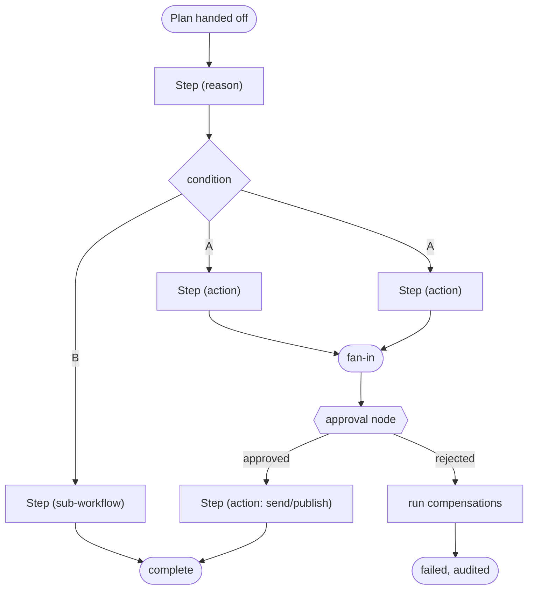
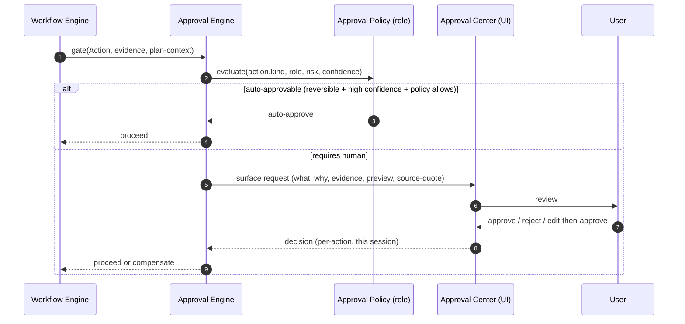
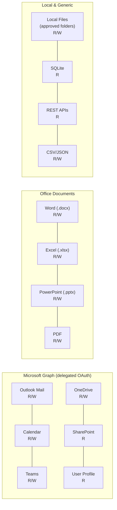
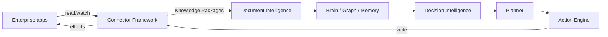
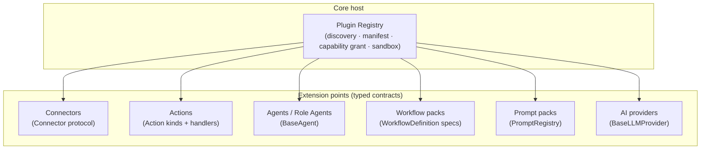

# 05 — Workflow Engine, Connectors & Plugin Architecture

> Deliverables covered: **#15** Workflow Engine · **#9** connector architecture · **#16**
> plugin architecture. Also: Approval Engine (§1.4), Document Intelligence (§4).

---

## 1. Workflow Engine (deliverable #15)

**Reuses & extends** the existing `app/workflows/engine.py` (`WorkflowEngine`,
`WorkflowDefinition`), `app/workflows/registry.py` (`WorkflowRegistry`, `build_default_specs`),
`app/workflows/autonomous.py` (autonomous cadences), and the runtime's retry policy
(`RetryPolicy` in `app/runtime/scheduler.py`). The engine already exists, is bus-attached,
and reports failures to the manager; v4 extends it with the control-flow primitives the
brief requires.

### 1.1 Capabilities

| Primitive | Design |
|-----------|--------|
| **Sequential** | Ordered Steps; each Step's output feeds the next (existing) |
| **Parallel** | Fan-out Steps on the in-process executor with a concurrency cap; fan-in barrier; results merged (new — uses LangGraph parallel nodes or a bounded thread pool) |
| **Conditional** | Branch on Step results / evidence predicates (`when:` guards on Steps) |
| **Retry policies** | Per-Step `RetryPolicy` (max attempts, backoff, jitter) — reuse the scheduler's existing policy type |
| **Compensation** | Each Step may register a compensating Action; on unrecoverable failure the engine runs compensations for committed Steps in reverse order (Saga pattern) |
| **Approvals / HITL** | An `approval` node pauses the workflow via LangGraph `interrupt()`; resumes on decision (§1.4) |
| **Scheduling** | Workflows can be triggered by the existing `EnterpriseScheduler` (cron/interval) or by events on the bus |
| **Templates** | Role- and task-templated workflows in `WorkflowRegistry` (e.g. "Weekly Report", "Meeting Follow-up", "Incident RCA draft") |

### 1.2 Execution model



Every Step delegates side-effects to the **Action Engine** — the Workflow Engine
orchestrates but never writes to apps itself (P1). State is checkpointed so a workflow
survives a Core restart and resumes at its last node.

### 1.3 Compensation (Saga)

Because Actions are individually reversible ([04](04-context-planner-action.md) §3.4),
plan-level integrity is achieved with compensations: `generate_report` ⇒ compensate
`withdraw_revision`; `move_file` ⇒ compensate `move_back`; `create_calendar_hold` ⇒
compensate `cancel_hold`. Compensations are themselves Actions (journaled, verifiable).

### 1.4 Approval Engine (human-in-the-loop)

**Extends** `app/governance/policies.py` (approval/retention policies already exist) and
the `ActionQueue` approval gate (`autonomy_requires_approval` already lists
`send_email`, `create_meeting`, `send_message`, …).



Policies are **configurable per role and per action kind** (e.g. Finance: any workbook
write ≥ threshold needs approval; Leadership: outbound exec email always needs approval).
Decision Intelligence supplies the risk/impact/confidence that policies test against —
the confidence→human routing already exists (`autonomy_confidence_threshold`). Approvals
are **per-action and never generalized** to future actions (matches the platform's action
policy).

### 1.5 Interface

```python
class WorkflowEngine:                       # extends existing
    def register(self, definition: WorkflowDefinition) -> None: ...
    def run(self, workflow_id: str, ctx: WorkflowContext) -> WorkflowRun: ...
    def resume(self, run_id: str, approval: Decision) -> WorkflowRun: ...
    def compensate(self, run_id: str) -> None: ...
    def status(self) -> dict: ...
```

---

## 2. Connector Framework (deliverable #9)

**Reuses** `app/connectors/` — `EnterpriseConnectorFramework`, the connector `registry.py`,
`base.py`, and the shipped `folder/excel/csv/database/postgres/tabular` connectors. The
framework is already **pluggable** (register once, the runtime syncs it, changes become
Knowledge Packages). v4 adds the Microsoft Graph and Office connectors and formalizes the
plugin contract.

### 2.1 Connector contract

```python
class Connector(Protocol):
    name: str
    capabilities: set[Capability]          # READ, WATCH, WRITE, SEARCH
    scopes: set[str]                        # OAuth/permission scopes it needs
    def health(self) -> HealthStatus: ...
    def read(self, query: SourceQuery) -> Iterable[Record]: ...
    def watch(self, cursor: Cursor) -> Delta: ...           # incremental
    def write(self, action: Action) -> WriteResult: ...     # for write-capable connectors
    def describe(self) -> ConnectorSpec: ...                # for catalogue + governance
```

- **Read connectors** feed the Context Manager and the Brain (ingest → chunk → embed →
  graph). **Write connectors** are the Action Engine's hands. Many are both.
- Every connector **declares its scopes and capabilities** so Governance, Role Management,
  and the Approval Engine can reason about it *before* it runs.
- Health is first-class: an unconfigured/offline connector reports unhealthy and its
  Actions **wait** in the queue (existing behaviour), never error the workflow.

### 2.2 v1 connector set



| Connector | Capabilities | Scopes / notes |
|-----------|--------------|----------------|
| Outlook Mail | READ, WATCH, WRITE(draft/send) | `Mail.Read`, `Mail.Send` — send is approval-gated |
| Calendar | READ, WRITE | `Calendars.ReadWrite` — invite send approval-gated |
| Teams | READ, WRITE(post) | `Chat.Read`, `ChannelMessage.*` — post approval-gated |
| OneDrive | READ, WATCH, WRITE | `Files.ReadWrite` |
| SharePoint | READ, SEARCH | `Sites.Read.All` |
| User Profile | READ | `User.Read` |
| Word / Excel / PowerPoint / PDF | READ, WRITE | local libs (`python-docx`/`openpyxl`/`python-pptx`/`pypdf`) — no Office install required |
| Local Files | READ, WATCH, WRITE | **approved folders only**, metadata-indexed |
| SQLite / REST / CSV / JSON | READ (+WRITE where safe) | existing connectors reused |

### 2.3 Microsoft Graph specifics

- One **delegated** access token (from [03](03-security-and-auth.md)) drives Mail,
  Calendar, Teams, OneDrive, SharePoint, Profile — a single sign-in, incremental scopes.
- **Incremental sync** via Graph delta queries (`watch`) so the Brain stays current
  without re-reading mailboxes; cursors persisted per source (existing cursor mechanism).
- **Rate-limit & resilience:** honor Graph `Retry-After`, exponential backoff, and the
  connector-health circuit breaker; offline → Actions wait.

---

## 3. Connectors are the ingest *and* the actuators



The same framework is both the **way knowledge gets in** (existing V2.1 role) and the
**way work gets done** (new write path). This symmetry is why we extend rather than
replace it.

---

## 4. Document Intelligence

**Reuses** `app/documents/` (parser, chunker, pipeline, store) for the *read* side and
`app/intelligence/connectors/{word,excel,pdf,csv}.py` for structured extraction. v4 adds
the *write* side in `app/office/`.

| Format | Read (existing) | Write / Generate (new `app/office/`) |
|--------|-----------------|--------------------------------------|
| **Excel** | profile, semantics, KPI discovery, series extraction (openpyxl) | update sheets, refresh formulas, insert rows, create charts, generate pivots, validate changes — formatting preserved |
| **Word** | parse, chunk, section-extract | generate from template, modify existing, maintain formatting, **track revisions**, reports |
| **PowerPoint** | parse | generate decks, update existing, maintain layouts, charts/tables, exec summaries |
| **PDF** | parse, OCR fallback, extract, compare | generate (export), summarize, extract, compare |
| **Markdown/CSV/Text** | parse | generate, merge |

Every write goes through the **Action Engine** (pre-image, verify, version) — Document
Intelligence proposes content; it does not save files itself. "Update the KPI workbook"
means: read via the Excel connector → Brain summarizes deltas grounded in evidence →
Action Engine writes the cells and **re-reads to verify** the values match the ledger →
new version saved.

---

## 5. Plugin architecture (deliverable #16)

Everything extensible in v4 is a **plugin behind a typed registry** — the pattern the
codebase already uses for tools (`ToolRegistry`+`spec_for`), agents (`AgentRegistry`+
`register_catalogue`), workflows (`WorkflowRegistry`+`build_default_specs`), and
connectors (`registry.py`). v4 unifies the extension points:



### 5.1 Plugin contract

- **Manifest** (`plugin.json`): id, version, publisher, **declared capabilities/scopes**,
  extension points it registers, and its signature.
- **Signed & verified.** Plugins are Authenticode-signed; the host verifies the signature
  and that requested capabilities are within enterprise policy before loading (no
  arbitrary code from untrusted sources — matches the security policy).
- **Capability-gated.** A plugin gets only the capabilities its manifest declares and the
  role/governance policy grants. A connector plugin declaring `Mail.Send` still hits the
  Approval Engine for actual sends.
- **Registered, not patched.** Plugins call `register(...)` on the relevant registry at
  load; they never monkey-patch the core (honours the additive-layer convention: keep
  `register/get/run/describe` signatures).
- **Isolable & disable-able.** Each plugin can be disabled (back to core behaviour) and,
  for higher assurance, out-of-process connectors can run in a sandboxed subprocess.

### 5.2 Distribution
Plugins ship as signed packages, deployable by IT (Intune) or from an enterprise plugin
catalogue. This is how **future connectors, actions, role agents, and workflow packs**
are added without shipping a new `EnterpriseAI.exe` — the pluggability the brief requires.

Continue to [06-brain-services-and-intelligence.md](06-brain-services-and-intelligence.md).
