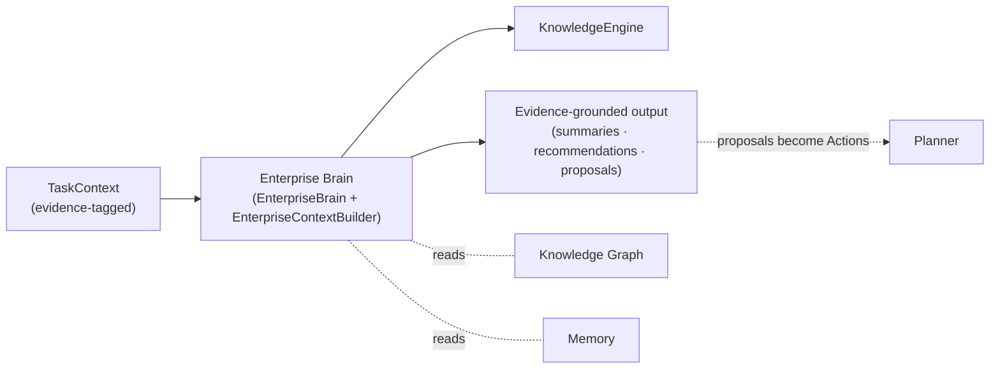
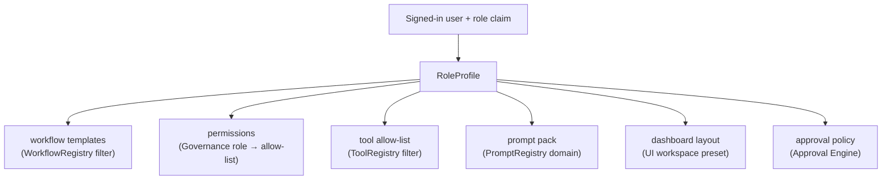
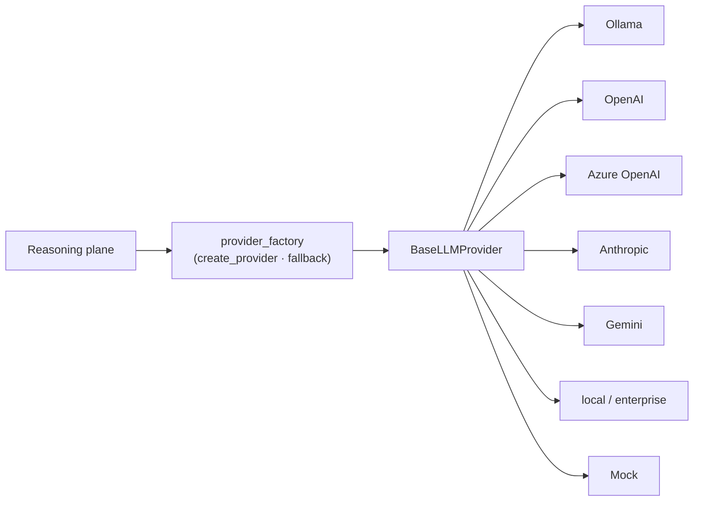

# 06 — Reasoning Services, Role Agents & AI Abstraction

> Deliverables covered: **#3** module responsibilities (reasoning services) · Role Agents
> · AI provider abstraction · plugin-backed intelligence.

This document describes the **retained** intelligence — the Enterprise Brain, Knowledge
Graph, Memory, and Decision Intelligence — now positioned as internal services beneath the
Planner, plus the two new-but-thin layers that make them role-aware and provider-agnostic.

---

## 1. Enterprise Brain (reason only)

`app/brain/` is retained essentially unchanged and *repositioned*: it is no longer the
product's top surface; it is the reasoning service the Task Planner and Context Manager
call.

**Responsibilities (retained):** reasoning, planning support, summarization,
recommendations, business understanding, document understanding, enterprise-knowledge
reasoning.

**The hard boundary (already true, now load-bearing):** the Brain never manipulates
Outlook, Excel, or files. It consumes a `TaskContext` (evidence-tagged) and produces
evidence-grounded narration, summaries, and proposals. All side-effects belong to the
Action Engine. This is what lets a reasoning bug degrade to "a worse suggestion" rather
than "a corrupted spreadsheet."

---

## 2. Knowledge Graph (business entities)

`app/knowledge/graph.py` (`EnterpriseKnowledgeGraph`) is retained. v4 continues the shift
**from documents to business entities** already begun in V3.1
(`ExecutiveIntelligence.build_business_graph`), representing:

Products · Projects · Meetings · Employees · Documents · KPIs · Merchants · Incidents ·
Tasks · Emails — with typed relationships (`OWNS`, `REPORTS_TO`, `AFFECTS`, `RESOLVES`,
`CAUSED_BY`, `HAS_KPI`, `MONITORS`, `USES`, `depends_on`, `implements`, …).

- **Per-laptop store:** the file-backed NetworkX store is the default (no graph server on
  a laptop, ADR-008). **Neo4j remains an optional mirror** via `EDIP_NEO4J_URI` for the
  fleet profile.
- **Feeds the Context Manager:** entity resolution ("which project/KPI is this task
  about") starts here, so discovery is scoped to a subgraph, not the whole disk.
- **Grown by connectors:** Graph deltas add/update entity nodes as mail, chats, meetings,
  and docs are synced (existing `_link_crossrefs`/`batch()`/`_relate()` machinery).

---

## 3. Memory Engine (extended for the desktop)

`app/memory/` (`MemoryManager`, `MemoryLifecycle`, `MemorySynchronizer`) is retained and
**extended** with the desktop-specific memory the brief lists:

| Memory kind | Source | Use |
|-------------|--------|-----|
| Recent files | Local/OneDrive connectors | fast context, "resume where you left off" |
| Recent conversations | Copilot store (existing) | continuity across sessions |
| Frequently used reports | Manager/report center (existing) | one-click regeneration |
| Business entities | Knowledge Graph | entity-scoped recall |
| Preferences | Wizard + usage (existing prefs) | role/UI/approval defaults |
| **Current task** | Planner | resume a plan after restart |
| Previous executions | Audit ledger + runtime store | learn approval patterns, avoid repeats |

Lifecycle (freshness, versions, expiry) is the existing `MemoryLifecycle`; the Brain reads
memory, the Planner writes current-task state, and everything persists to disk for
crash-recovery.

---

## 4. Role Agents & Role Management

**Purpose.** Different roles get different workflows, permissions, tools, prompts, and
dashboards. This is a thin new `app/roles/` layer that **configures** existing components
per role — it introduces no parallel execution path.

| Role | Emphasis (templates & dashboards) |
|------|-----------------------------------|
| Product Manager | roadmap/report drafting, KPI watch, stakeholder updates |
| Business Analyst | data pulls, analysis workflows, requirement docs |
| Data Analyst | workbook/pivot generation, dataset profiling |
| Finance | financial workbook updates (strict approval), variance reports |
| HR | policy docs, scheduling, comms (PII-sensitive redaction on) |
| Operations | incident follow-ups, RCA/SOP drafting, status comms |
| Leadership | executive brief, decision review, approvals |
| Compliance | audit review, retention, policy checks |
| Support | ticket summaries, response drafting |

A `RoleProfile` is data (a config object), not code: it selects from the **existing**
registries. Adding a role = adding a profile + optional workflow pack (a plugin), never a
new subsystem. This reuses `GovernanceLayer` (RBAC/permissions), `PromptRegistry`
(`app/prompts/domains/*` already has executive/analytics/reports/rca/sop/meetings), the
tool/agent/workflow registries, and the existing specialist agents
(`app/agents/specialists.py`).

---

## 5. AI provider abstraction

`app/llm/` is retained wholesale — it already implements the provider abstraction the
brief asks for:

- **On-device default (P4):** shipped builds default to **Ollama / a local model** —
  privacy-preserving, offline-capable, no data egress. Cloud/enterprise providers are
  explicit config opt-in (`EDIP_LLM_PROVIDER`, keys via keystore only).
- **Fallback chain:** the existing primary→fallback mechanism
  (`create_fallback_provider`) gives resilience (e.g. local primary, enterprise-hosted
  fallback).
- **Swap by config only:** no code change to switch providers — the abstraction and factory
  already guarantee this. New providers are plugins (`BaseLLMProvider`).
- **Grounding is provider-independent:** whatever the model, output passes the same
  evidence verifier and response validator before it becomes an Action payload.

---

## 6. Decision Intelligence (feeds approvals)

`app/runtime/intelligence.py` (`DecisionIntelligence`), `app/runtime/decisions.py`
(`DecisionEngine`), and `app/executive/` are retained. Their role in v4:

- **Priority scoring, risk estimation, impact analysis, execution confidence, approval
  suggestion** — the exact list the brief requires — already implemented (7-factor
  weighted ranking, Laplace-smoothed historical approval-rate learning).
- **Wired into the Approval Engine:** the confidence→human routing
  (`autonomy_confidence_threshold`) becomes the Approval Engine's default policy input;
  risk/impact scores parameterize per-role approval thresholds
  ([05](05-workflow-connectors-plugins.md) §1.4).
- **observe → propose → rank → decide → learn** continues on the local scheduler sweep,
  now proposing *work* (drafts, updates) as well as decisions, all of which flow through
  the Planner → Approval → Action pipeline.

Continue to [07-flows-and-class-model.md](07-flows-and-class-model.md).
