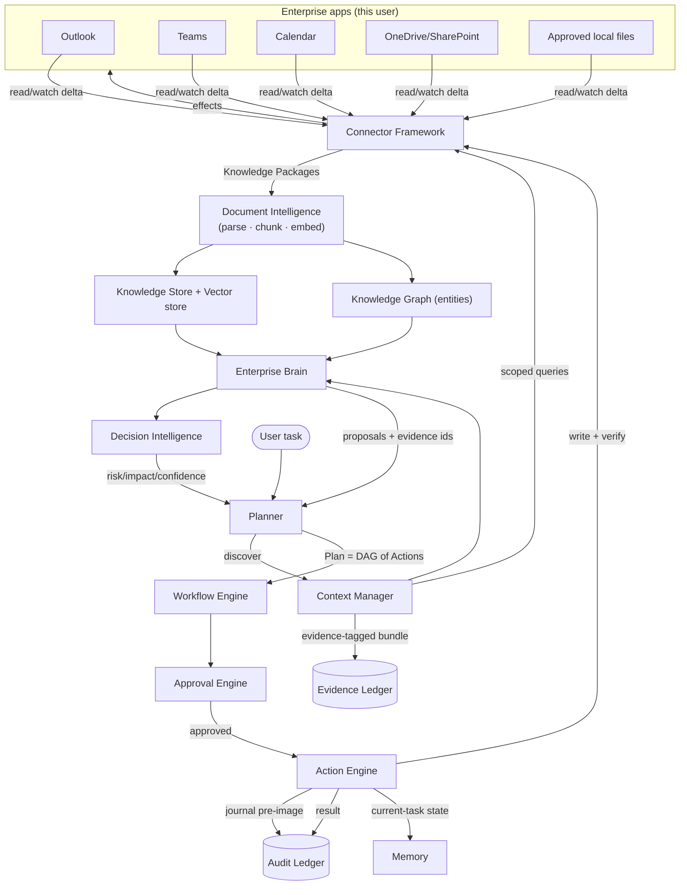
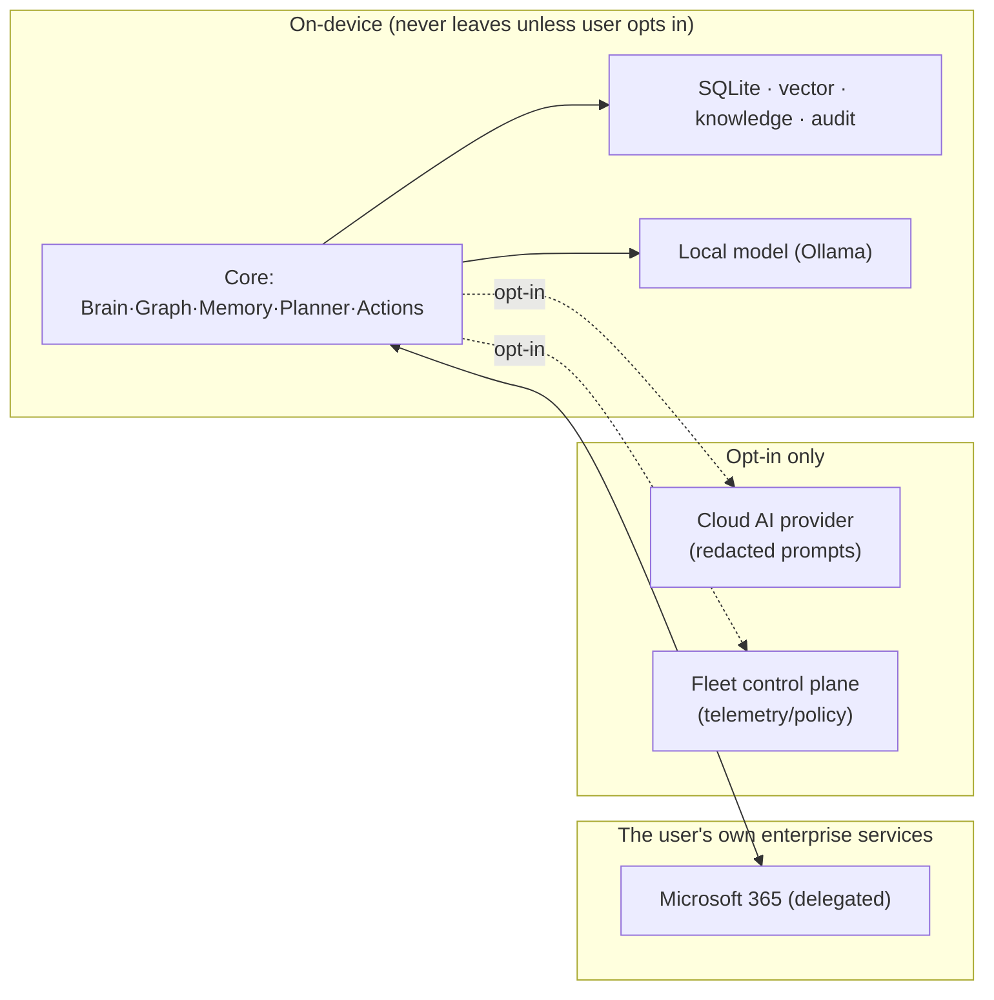
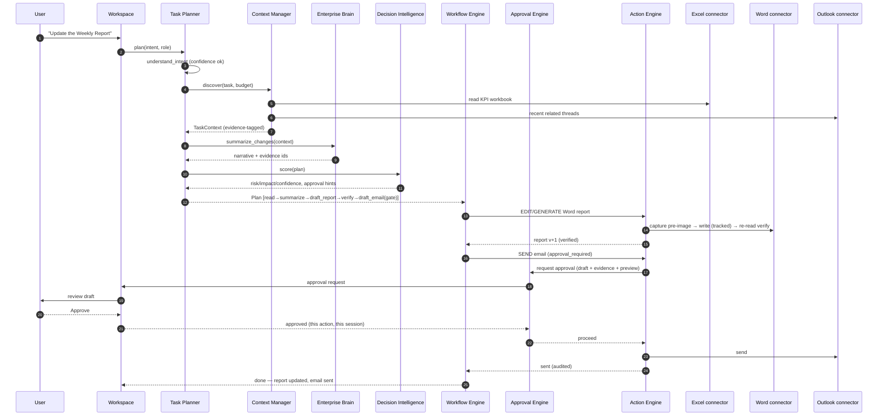
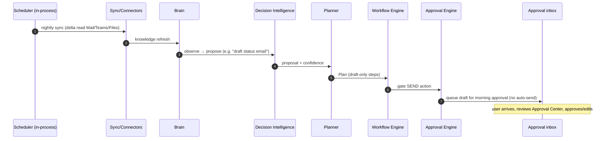
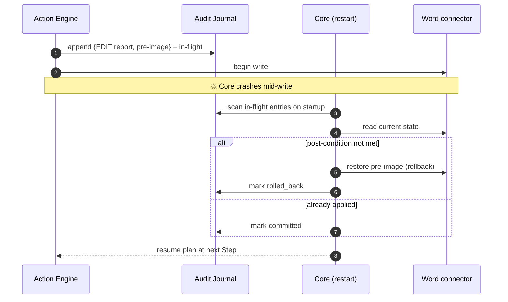
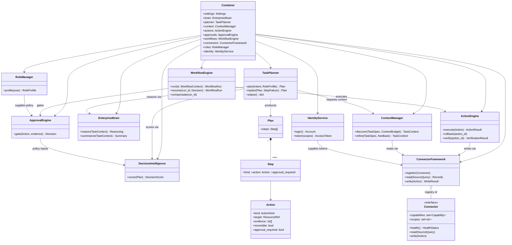

# 07 — Data Flow, Sequence Diagrams & Class Model

> Deliverables covered: **#4** data flow diagrams · **#5** sequence diagrams · **#7** class
> relationships.

---

## 1. Data flow (deliverable #4)

### 1.1 End-to-end: from enterprise apps to completed work

**Two directions through one framework:** knowledge flows *up* (read/watch → Brain);
work flows *down* (Plan → Action Engine → write). The Evidence Ledger and Audit Ledger are
the two immutable records that make every claim and every effect accountable.

### 1.2 Trust/data-boundary view

---

## 2. Sequence diagrams (deliverable #5)

### 2.1 "Update the Weekly Report" (the flagship flow)

### 2.2 Autonomous overnight cadence (no user present)

External effects are **drafted, never auto-sent** while unattended — the Approval Engine
holds them (existing "queued until approved" behaviour).

### 2.3 Crash mid-edit → safe recovery

---

## 3. Class relationships (deliverable #7)

**Dependency direction (enforced by the DI Container as the only composition root):** the
Planner depends on the reasoning services and produces a Plan; the Workflow Engine depends
on the Approval and Action Engines; the Action Engine depends only on the Connector
Framework. **No reasoning class depends on a connector or the Action Engine** — the
reason/act separation (P1) is a compile-time property of the class graph, not a convention.

Continue to [08-delivery-migration-readiness.md](08-delivery-migration-readiness.md).
