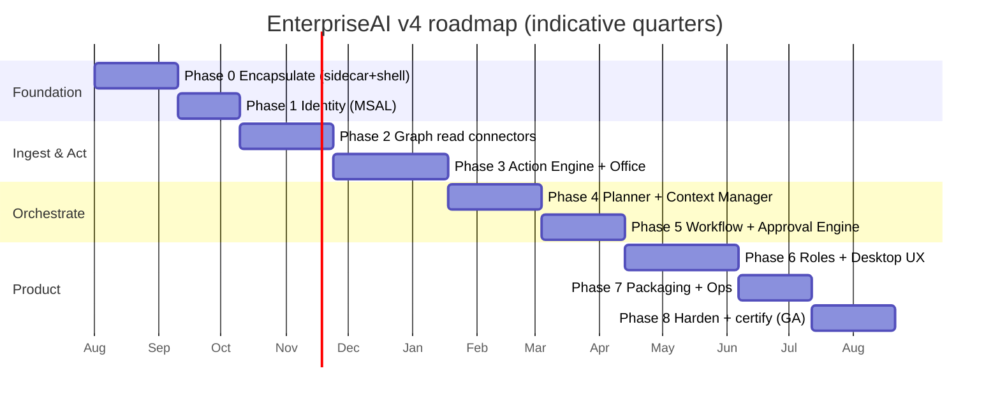
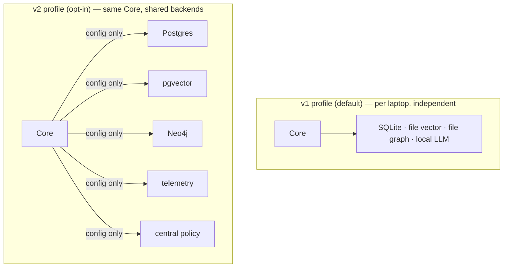

# 08 — Migration, Roadmap, Risk, Performance, Scalability & Readiness

> Deliverables covered: **#21** migration plan · **#20** development roadmap · **#22** risk
> analysis · **#23** performance strategy · **#24** scalability strategy · **#25**
> production-readiness checklist.

---

## 1. Migration plan from the existing project (deliverable #21)

The guiding rule: **migrate by wrapping and extending, never by rewriting.** The existing
`backend/` runs as the Core sidecar with zero internal changes in Phase 0; each subsequent
phase adds a v4 layer behind an `EDIP_*_ENABLED` flag, exactly as V2.1–V3.1 layers were
added, so the platform is shippable and reversible at every step.

| Phase | Goal | Work | Disposition of existing assets |
|-------|------|------|-------------------------------|
| **0 — Encapsulate** | Existing web app runs as a local sidecar | Bind `main.py` to `127.0.0.1`; per-launch bearer token; PyInstaller freeze; Tauri shell hosting the existing React UI in WebView2; supervise lifecycle | **All retained, unchanged.** Web deploy still works |
| **1 — Identity** | Real per-user Microsoft sign-in | Build `app/identity/` (MSAL); wire tokens into `communication/graph.py`; keystore cache | Replaces the auth *stub*; connectors unchanged |
| **2 — Read connectors** | Brain learns from the user's real M365 | Implement Graph read/watch connectors (Mail/Teams/Calendar/OneDrive/SharePoint) on the **existing** connector framework; delta cursors | Framework, Document Intelligence, Brain retained; **Synthetic Enterprise Generator moved to `tools/demo/`** |
| **3 — Action Engine** | The app can *do* reversible internal work | Build `app/actions/` + `app/office/` (Word/Excel/PPT/PDF write, journaling, verify, rollback); promote `tools/planned.py` stubs to real Actions | Copilot/tools reused as read side |
| **4 — Planner + Context** | Task → plan → scoped context | Build `app/planner/` (LangGraph plan graph over existing `planning.py`) and `app/context/` (over `sync/search.py`, `copilot/context.py`) | Reasoning/evidence contracts reused |
| **5 — Workflow + Approval** | Multi-step, gated, compensating work | Extend `workflows/engine.py` (parallel/conditional/compensation/HITL); build `app/approvals/` over governance policies + queue gate | Existing workflows/cadences retained |
| **6 — Roles + Desktop UX** | Role-aware workspace that feels native | Build `app/roles/` (profiles over governance/registries); `frontend/src/shell` (tabs, dock, command palette, approval center, global search, dark mode, a11y) | Existing pages reused inside the workspace |
| **7 — Packaging + Ops** | Signed installer, wizard, auto-update, telemetry | WiX/MSIX signing; first-run wizard; Tauri updater; OTel local + crash recovery hardening | Observability dashboard reused |
| **8 — Harden + certify** | Production sign-off | Security review, pen-test of the loopback/IPC/plugin surface, performance tuning, readiness checklist (§6) | — |

**Data migration:** none for employee installs — each is greenfield local state seeded by
the wizard. The synthetic corpus and any dev fixtures stay in `tools/demo/` and are never
shipped.

**Reversibility:** every phase's new layer is `EDIP_*_ENABLED`. Turning them all off
yields exactly today's v3.1 behaviour, which is the regression baseline (572+ backend
tests must stay green throughout — the existing "closed-set" test discipline applies).

---

## 2. Development roadmap (deliverable #20)

**Milestone gates (each is a shippable internal build):**
- **M1 (end P1):** app installs, signs into Microsoft, shows the existing dashboards on
  the user's tenant identity.
- **M2 (end P3):** the app performs a **verified, reversible** local action (edit a
  workbook, generate a Word report) — the first "does work" proof.
- **M3 (end P5):** the flagship "Update the Weekly Report" flow runs end-to-end with a
  real approval gate.
- **M4 (end P6):** role-aware desktop workspace, pilot-ready for a friendly team.
- **GA (end P8):** signed installer, auto-update, telemetry, security-certified.

---

## 3. Risk analysis (deliverable #22)

| # | Risk | Likelihood | Impact | Mitigation |
|---|------|-----------|--------|-----------|
| R1 | **Automation corrupts a user's file** (bad edit) | Med | High | Pre-image + verify + rollback in the Action Engine (P2); soft-delete quarantine; per-action journaling; verified against evidence ledger |
| R2 | **Prompt injection** from a malicious email/doc drives a bad action | Med | High | Instruction/data separation; Action allow-listing; human gate on all outward effects with source quoted ([03](03-security-and-auth.md) §5) |
| R3 | **Wrong / unauthorized send** (mail to wrong recipient) | Med | High | Approval Engine per-action gate; recipients only from user/authorized directory, never from content; preview-before-send |
| R4 | **Token/secret leakage** | Low | High | Tokens only in Credential Manager; never in UI process, logs, or files; loopback-only Core with bearer token |
| R5 | **PyInstaller/Tauri startup slow or AV false-positive** | Med | Med | One-folder freeze; EV code signing; AV allow-list guidance for IT; warm-start splash |
| R6 | **Graph API throttling / offline** breaks tasks | Med | Med | Delta sync + backoff + circuit breaker; offline → Actions wait, never fail; idempotent retries |
| R7 | **On-device LLM too weak** for planning quality | Med | Med | Provider abstraction with cloud/enterprise fallback; deterministic-first so LLM only narrates/plans, never computes |
| R8 | **Per-laptop store grows unbounded** | Low | Med | Memory lifecycle expiry; retention policies; vector store compaction; approved-folders scope caps ingest |
| R9 | **Fleet management burden** (10k installs) | Med | Med | Intune/SCCM MSIX; machine-policy config; staged auto-update; optional central telemetry |
| R10 | **Scope creep vs. reversibility** | Med | Med | Strict additive-layer discipline + `EDIP_*_ENABLED` gates; keep v3.1 as the regression baseline |
| R11 | **Plugin supply-chain risk** | Low | High | Signed, capability-gated plugins; policy-checked at load; optional subprocess sandbox |
| R12 | **Data egress to cloud AI** violates policy | Low | High | On-device default; cloud is explicit opt-in + redaction; machine policy can forbid cloud providers |

---

## 4. Performance strategy (deliverable #23)

**Targets (per-laptop, mainstream corporate hardware):** cold start to interactive < 4 s;
task-plan preview < 2 s; typical single-Action write < 1 s; UI always responsive (never
blocked on the Core).

| Concern | Strategy |
|---------|----------|
| **Startup** | One-folder PyInstaller; lazy-build heavy engines (DI container already lazy-caches singletons); shell shows UI immediately while Core warms |
| **UI responsiveness** | Two-process split keeps the shell native and non-blocking; long tasks stream progress over SSE (already supported) |
| **Context discovery** | Task-scoped, budgeted, ranked — never full-disk; embedding + result caches keyed by mtime (existing pattern) |
| **LLM latency** | On-device model sized to hardware; deterministic-first means most facts need no LLM; prompt-cache; fallback provider for heavy asks |
| **Sync cost** | Delta queries not full reads; incremental cursors; nightly full-sweep off-hours; connector health circuit breaker |
| **Storage I/O** | SQLite WAL; vector store compaction; JSON stores read fresh but small; batch graph writes (`graph.batch()` already used) |
| **Memory footprint** | Lazy engine construction; bounded context budget; stream large documents rather than loading whole |
| **Background work** | In-process scheduler at a modest tick; idempotent, catch-up-safe jobs; throttle on battery/low-power |

Performance is observable: the existing `LatencyTracker` + observability dashboard sample
the hot path (`observability_latency_enabled`), surfaced in diagnostics.

---

## 5. Scalability strategy (deliverable #24)

Two independent axes:

**5.1 Per-laptop (data & task scale).**
- Scope, don't scale: approved-folders + task-scoped discovery cap the working set
  regardless of disk size.
- Memory lifecycle + retention keep local stores bounded.
- The graph and vector stores are file-backed and adequate for one user's business
  entities; no server needed (ADR-008).

**5.2 Fleet (thousands of installs).**
- **Horizontal by construction:** installs are independent — N laptops = N isolated
  runtimes, no shared bottleneck, linear scaling with zero central load (P5).
- **Optional central control plane (config-only, already supported):** point Core at
  shared infra — `EDIP_DATABASE_URL` (Postgres control plane), `EDIP_PGVECTOR_URL`,
  `EDIP_NEO4J_URI` (shared graph), `EDIP_MLFLOW_URI`, OTLP telemetry export, central
  Governance policy. This gives fleet-wide policy, telemetry, and optional shared
  knowledge **without changing the product** — it's the same Core in a different profile
  (this is exactly the v3 web architecture, reused).
- **Deployment scale:** MSIX + Intune/SCCM handle thousands of installs, staged updates,
  and machine policy; the app itself needs no scaling because it never centralizes.

---

## 6. Production-readiness checklist (deliverable #25)

**Architecture & code quality**
- [ ] Reason/act separation enforced in the class graph (no reasoning module imports a connector/Action Engine)
- [ ] Every new layer behind an `EDIP_*_ENABLED` flag; all-off == v3.1 behaviour
- [ ] DI container is the only composition root; SOLID / repository / service-layer patterns preserved
- [ ] No hardcoded paths/secrets; 100% config-driven (`EDIP_*`); env-reference-only credentials
- [ ] 572+ existing backend tests green + new suites for identity, connectors, actions, planner, approvals

**Security**
- [ ] MSAL delegated OAuth; no password fields; tokens only in Credential Manager
- [ ] Local stores DPAPI-encrypted; loopback-only Core with per-launch bearer token
- [ ] Approval gates on all send/delete/publish/financial-write actions; per-action, non-generalized
- [ ] Prompt-injection defenses verified (instruction/data separation, allow-listing, human gate)
- [ ] Signed binaries + plugins; SBOM produced; supply-chain scan clean
- [ ] Machine-policy config overrides for locked-down deployments
- [ ] Independent security review + pen-test of IPC/loopback/plugin surfaces

**Reliability**
- [ ] Action journaling + rollback verified against crash-mid-write
- [ ] Supervised Core restart with backoff; scheduler cron catch-up idempotent
- [ ] Offline tolerance: external Actions wait, never lose data
- [ ] Workflow checkpoint/resume + compensation verified

**Desktop UX**
- [ ] Tabbed workspace, dockable panels, command palette, global search, notifications, dark mode
- [ ] Accessibility (keyboard nav, screen-reader labels, contrast) audited
- [ ] First-run wizard: sign-in → permissions → folders → AI provider → role
- [ ] Feels responsive (targets in §4 met); never blocks on Core

**Observability & ops**
- [ ] Structured logs + local OTel; optional fleet OTLP export (opt-in)
- [ ] Health/diagnostics panel composes every layer's `status()`
- [ ] Crash reporting with redaction; execution history + audit ledger exportable
- [ ] Telemetry is opt-in and privacy-reviewed

**Packaging & deployment**
- [ ] Signed MSIX; silent-install capable; per-user, no admin for the app
- [ ] Tauri auto-update (signed deltas), staged/pinnable via Intune; one-generation rollback
- [ ] Entra ID app registration + admin-consent runbook for IT
- [ ] Uninstall + "wipe local data" removes stores, MSAL cache, keystore entries

**Governance & compliance**
- [ ] Retention + audit policies configurable and tamper-evident
- [ ] Data-residency default on-device; every egress path explicit + logged
- [ ] Right-to-erasure supported

Continue to [09-decision-log.md](09-decision-log.md).
